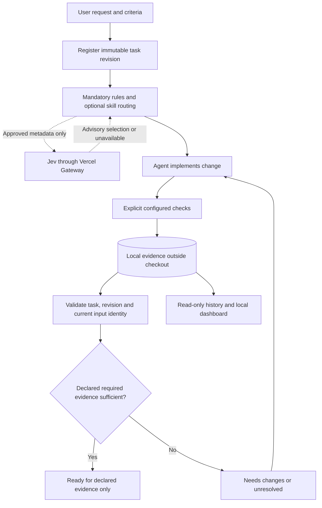

# Agent Checkpoint

Local task contracts, recorded verification, and evidence-backed completion for
coding agents. The goal is better accepted outcomes with measurable time and cost,
not simply more model calls.

**Publication stage:** `main` initially contains this overview and Git exclusions.
The existing implementation is being introduced through the four PRs below. Use
the complete validation branch to inspect the assembled project before merging.
Commands here require the runtime PR; integration examples require the harness PR.
This is an experimental internal MVP, not a production release.

## Review and merge plan

| Order | Branch / PR scope | Base | What to review |
|---|---|---|---|
| 1 | [Runtime](https://github.com/JuanFKurucz/agent-checkpoint/tree/codex/runtime-foundation) | `main` | Python package, contracts, SQLite evidence, runner, CLI/MCP, Gateway advice, dashboard, tests, lockfile |
| 2 | [Architecture](https://github.com/JuanFKurucz/agent-checkpoint/tree/codex/architecture-docs) | `codex/runtime-foundation` | Product boundaries, research, ADRs, interfaces, roadmap and publication plan |
| 3 | [Harness integration](https://github.com/JuanFKurucz/agent-checkpoint/tree/codex/harness-integration) | `codex/architecture-docs` | Operating guides, agent instructions, portable MCP template and Jev example |
| 4 | [Validation](https://github.com/JuanFKurucz/agent-checkpoint/tree/codex/validation-evidence) | `codex/harness-integration` | Verification utilities, historical measurements, Garden reports, audits and handoffs |

These are stacked PRs: each compares against the preceding branch, not all of
`main`. Review in order. After a predecessor merges, retarget its successor to
`main` and inspect the resulting diff before merging. Prefer merge commits for
this initial stack; squash/rebase merges require explicit reconciliation of the
remaining branches. No automatic merge or candidate promotion is part of this plan.

The runtime and dashboard stay together because reporting, MCP and the CLI already
share interfaces. The measurement helper required by a runtime test travels with
that test; the remaining verification utilities are in PR 4.

## What it does

1. Registers a request and immutable, additive task criteria.
2. Suggests optional skills while preserving mandatory repository instructions.
3. Runs explicitly configured checks and records outputs and identities.
4. Reports whether the declared evidence is current and sufficient.
5. Exposes bounded history and a local, read-only observatory.

Jev supplies optional routing and criterion-review advice. It cannot mark a
required check passed, waive a criterion, authorize a command, or override a
failure. Review is opt-in; completion never invokes a model or runs checks.



`ready` does not prove every natural-language requirement was tested, that code
is secure, or that a human accepted the result. Failed, missing, stale, interrupted
and unavailable evidence are intentionally different states.

## Architecture and trust boundaries

The Python core shares a service across CLI and MCP adapters. Strict contracts
describe task revisions, check definitions, evidence and completion. SQLite stores
durable events; snapshots associate results with a worktree, inputs and policy.
The runner executes configured argument vectors, not arbitrary tool-supplied shell
commands. Windows descendant-process cleanup is tested.

Checks run against the working tree, without isolated-snapshot or hostile-process
sandbox guarantees. Environment filtering is not a sandbox. Local filesystem access
is a trust boundary; authenticated evidence authority remains unfinished work.

The dashboard binds to loopback and uses a temporary session capability, origin
checks and local assets. It displays history, traces, known/unknown usage and a
decision overview, with JSON and Mermaid-source exports. It never runs repairs,
refreshes readiness or sends hosted telemetry. The overview is HTML/CSS, not a
live Mermaid renderer. Do not share the printed capability URL.

## Setup and direct verification

The development baseline is Windows, Python 3.13 and the checked-in `uv.lock`.
Git and Node.js are required by parts of the development suite; Node is not needed
for the installed Python runtime. Other platforms are not certified by the local
Windows evidence. From a runtime-containing branch:

```powershell
uv sync --locked --extra jev
uv run --locked --extra jev ruff check src tests scripts
uv run --locked --extra jev ruff format --check src tests scripts
uv run --locked --extra jev mypy
uv run --locked --extra jev pytest -q
uv build --no-sources
```

Tests deny sockets by default and use temporary state. No credential or live model
is needed. Installing dependencies can require network access.

For a disposable trial, copy `checkpoint.example.json` to `checkpoint.json` only
if no local configuration exists. Review it before running checks. Its provider
is disabled; copying a configuration is not spend approval. Keep request files,
contract files and runtime state outside the evaluated repository.

```powershell
uv run --locked --extra jev agent-checkpoint doctor --json
uv run --locked --extra jev agent-checkpoint task start --request-file REQUEST.md --contract-file CONTRACT.json
uv run --locked --extra jev agent-checkpoint route --task TASK --kind skill
uv run --locked --extra jev agent-checkpoint check run --task TASK lint format types tests
uv run --locked --extra jev agent-checkpoint complete --task TASK --json
uv run --locked --extra jev agent-checkpoint report --task TASK
uv run --locked --extra jev agent-checkpoint dashboard --port 0
```

Replace `REQUEST.md` and `CONTRACT.json` with external paths and `TASK` with the
returned ID. A minimal contract contains `criteria`, for example:

```json
{"criteria":[{"id":"regression","text":"Specified behavior has regression coverage","check_ids":["tests"]}]}
```

These commands exercise the candidate, not an active supervisor. For self-development,
use a separately validated, noneditable installation N to supervise candidate N+1.
Never make the editable candidate its own supervisor.

## Codex, Claude Code and Jev

The authoring environment uses a separately installed 0.1.2 supervisor; native
Codex invocation of its five MCP tools was verified. Candidate 0.1.9 adds completion
diagnostics, reports, traces and dashboard focus preservation; its standalone
six-tool MCP smoke was tested. It has not been promoted into that active connection.
A fresh clone does not inherit the author's installation.

Claude Code integration, native hooks and independent CI certification remain
unfinished. The harness PR's MCP template requires operator-selected absolute paths
and a host reload; it does not automatically install or enable anything.

The only supported live model path is `typesafe-ai/jev` through Vercel AI Gateway,
with `AI_GATEWAY_API_KEY`. Never commit or print a key. `.env.local` and local
configuration are ignored. Calls require explicit payload/spend approval. The
authoring policy permits task/skill metadata and criterion/check-status summaries,
not implicit raw source or output uploads: six physical requests per task, 16 KiB
input, a 10-second deadline, no retries or fallback. The reported account budget is
not an application-enforced dollar cap. Hosted tracing is disabled.

## Evidence and limitations

The recorded 0.1.9 Garden trial finished six paired website/tool iterations with
180 Checkpoint tests and 17 website tests, plus documented browser observations.
It exercised recovery, history, observability, context diagnostics, event pairing
and keyboard focus. Fourteen Jev routing requests were recorded across those trial
tasks; billing remained unknown. These are historical results, not new PR CI runs.

Earlier controlled micro-workflows measured added harness overhead. General coding
quality, latency or cost improvements are **not established**. The separate Garden
website and machine-local databases/artifacts are not bundled here. Reports describe
their original locations but cannot replace those artifacts. Research exports are
historical inputs, not authoritative runtime documentation.

## Next steps

- Review and merge the four-PR stack in order; preserve direct recovery commands.
- Design authenticated criterion/evidence authority without weakening readiness.
- Measure end-to-end overhead and quality against comparable baseline tasks.
- Add reproducible browser automation and portable Garden fixtures.
- Improve safe task labels and observability based on measured friction.
- Validate isolated promotion/rollback before changing the active supervisor.
- Establish CI and separately test Claude/native-hook integration.

On the complete branch, start at `docs/status.md` and `docs/README.md`; then read
`docs/planning/publication-plan.md`, `docs/architecture/overview.md`, the ADR index,
`docs/guides/internal-runtime.md` and `docs/reports/garden-final-assessment.md`.
Some cross-links resolve only after the entire stack is present. Historical dates,
local paths and installation claims are not fresh-clone setup instructions.

