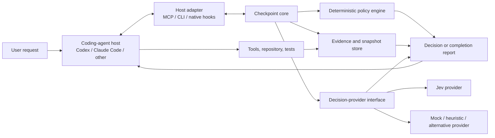

# Agent Checkpoint: Exploratory Research Brief

**Status:** Working exploration, not an implementation specification

**Audience:** Agent-platform engineers, applied-AI researchers, developer-tooling researchers, and maintainers of Codex/Claude Code integrations

**Source:** [`INITIAL_CONVERSATION.md`](./INITIAL_CONVERSATION.md)

**Primary decision:** Determine whether a reusable decision-and-evidence layer can improve coding-agent outcomes while reducing, or at least justifying, total latency and cost

## 1. Purpose of this document

The initial conversation proposes a portable toolkit—provisionally named **Agent Checkpoint**—that places Jev beside a coding agent as a bounded decision provider. The coding agent still interprets the request, edits code, invokes tools, and communicates with the user. Agent Checkpoint helps it decide what resources to use, what evidence to collect, and whether the work is genuinely ready to finish.

This document develops that idea into a researchable product hypothesis. It is intended to:

- make the proposed system and its boundaries precise;
- connect individual Jev decisions to measurable system-level outcomes;
- identify where Codex, Claude Code, MCP, hooks, and repository-local policy would fit;
- distinguish established constraints from hypotheses that still need evidence;
- define experiments that can falsify the idea before a large implementation investment; and
- give the research team a prioritized set of questions to answer.

This is intentionally not a detailed build plan. Several claims in the source conversation refer to Jev and agent-host capabilities without durable source links. Those claims should be verified against current primary documentation before they become requirements.

## 2. The idea in one sentence

> Add a small, host-neutral control layer that uses deterministic rules first and Jev only for bounded semantic decisions, so coding agents select better resources, carry less irrelevant context, verify against fresher evidence, and stop less often with incomplete work.

The important unit of optimization is the **whole task**, not the individual Jev request. A checkpoint can be locally expensive and still be valuable if it prevents an unnecessary large-model turn, a bad subagent delegation, a context-heavy retry, or a premature completion. Conversely, a fast and cheap checkpoint is harmful if it creates extra loops without improving the final result.

## 3. Working thesis

Coding agents repeatedly make a small set of consequential decisions:

1. What kind of task is this?
2. Which instructions, skills, tools, models, or specialist agents are relevant?
3. What repository evidence is worth putting into the expensive model's context?
4. What checks are required after the change?
5. Does the available evidence support every completion claim?
6. Should the agent continue, escalate, abstain, or stop?

Today, those decisions are often made inside the same large context and by the same model that performs the coding. This is simple, but it can waste tokens, over-select resources, repeat repository discovery, or accept its own unsupported completion claim.

Agent Checkpoint would externalize selected decisions into explicit, observable contracts. Jev is a candidate semantic decision provider because the initial research describes it as returning constrained selections, rubric results, and probabilities rather than generating code or executing tools. Deterministic code would still control eligibility, permissions, schemas, evidence freshness, retry limits, and hard quality gates.

The thesis has three parts, all of which must be tested separately:

- **Quality hypothesis:** bounded, independent decisions reduce routing mistakes and false-ready completions.
- **Efficiency hypothesis:** those improvements save more agent work than the checkpoints add.
- **Portability hypothesis:** one core can serve Codex, Claude Code, and generic MCP/CLI clients without reducing every host to an unreliable lowest common denominator.

Failure of any one hypothesis changes the product. For example, accurate routing that adds net latency and cost may still be useful in a quality-first mode, but it would not support the stronger efficiency claim.

## 4. Product boundary

### 4.1 What Agent Checkpoint would be

Agent Checkpoint would be a repository-installable toolkit with four responsibilities:

- **Decision support:** recommend among known, allowed skills, models, agents, checks, or evidence candidates.
- **Task contracts:** record what the user requested, what repository policy adds, and what the agent inferred.
- **Evidence management:** associate verification results with an exact task, policy revision, and workspace snapshot.
- **Completion reporting:** resolve each acceptance criterion to `pass`, `fail`, `unknown`, or `not_applicable`, with evidence references and bounded next actions.

It would expose the same core through:

- an MCP server for portable, explicit agent access;
- a CLI for humans, scripts, CI, and hosts without MCP;
- thin native adapters for lifecycle automation in Codex and Claude Code; and
- an optional workflow skill that teaches an agent when and how to call it.

### 4.2 What it would not be

Agent Checkpoint should not be presented as:

- a code-generating model;
- a replacement for the host agent's planner or tool runtime;
- a security boundary that can make unsafe execution safe;
- a universal software-quality score;
- proof that tests passed when it did not run or observe those tests;
- an autonomous architecture authority; or
- an enforcement mechanism that is equally strong in every host.

These non-goals are product safeguards. The toolkit becomes less trustworthy if a semantic judgment can silently override a failed command, stale evidence, a repository permission, or an explicit user instruction.

## 5. Design principles

### 5.1 Deterministic before probabilistic

Use code for facts that code can establish: whether a resource exists, whether a command exited successfully, whether a file changed after a test run, whether a dependency violates an allowlist, or whether a required field is missing. Use Jev only when the remaining question genuinely requires contextual judgment.

### 5.2 Narrow decisions, explicit candidates

Do not ask, “What should the agent do next?” Ask, “Which, if any, of these allowed skills is relevant to this task?” Candidate construction belongs to trusted code. Jev may rank or select candidates, but it must not invent executable identifiers or permissions.

### 5.3 Evidence before claims

“Tests pass” is a claim. A recorded execution against the current workspace is evidence. Completion logic must preserve that distinction.

### 5.4 Unknown is a valid result

An unavailable provider, missing context, unobserved command, or ambiguous criterion must not collapse into success. The system should make uncertainty visible and decide—by repository policy—whether to continue, ask a human, or finish with an unresolved report.

### 5.5 Optimize the task, not the checkpoint

The goal is not to minimize Jev latency in isolation. The goal is to improve task success, time to a correct result, and total spend across every model call, tool call, retry, and reviewer pass.

### 5.6 Advice and authority are separate

In early releases, semantic judgments should be advisory. Mechanical checks can become enforceable when explicitly configured. A repository owner, not a model confidence threshold, determines what may block completion.

### 5.7 Host-native behavior, shared semantics

Codex and Claude Code should use the same task, evidence, and decision contracts. Their adapters may differ because lifecycle events, continuation controls, configuration, and agent discovery differ. Portability should mean shared behavior and data—not identical plumbing.

## 6. Proposed system model



The provider boundary is essential. If the product works only when Jev is hard-coded throughout the application, it will be difficult to evaluate whether Jev itself adds value, compare it with simpler baselines, run deterministic tests, or support offline use.

### 6.1 Core components

| Component | Responsibility | Must remain provider-independent? |
|---|---|---:|
| Task-contract service | Stores requirements, scope, origin, and revisions | Yes |
| Catalog service | Discovers and normalizes skills, agents, models, and checks | Yes |
| Policy engine | Filters candidates and combines deterministic and semantic results | Yes |
| Evidence collector | Records tool/check results with provenance | Yes |
| Snapshot service | Detects whether evidence is still current | Yes |
| Decision provider | Answers bounded semantic questions | Interface only |
| Completion service | Evaluates criteria and produces next actions | Yes |
| Host adapter | Maps native events and capabilities to core calls | Yes |
| Installer/doctor | Adds, verifies, updates, and removes integration safely | Yes |

### 6.2 A common decision envelope

Every semantic decision should be represented with enough metadata to reproduce and analyze it:

```json
{
  "decision_id": "dec_123",
  "task_id": "task_456",
  "kind": "skill_route",
  "input_fingerprint": "sha256:...",
  "policy_revision": "policy_7",
  "provider": "jev",
  "provider_model": "pinned-model-id",
  "candidates": ["backend-testing", "api-design", "none"],
  "result": "backend-testing",
  "confidence": 0.81,
  "status": "decided",
  "latency_ms": 143,
  "usage": {
    "request_units": 1
  },
  "created_at": "2026-09-27T14:00:00Z"
}
```

The exact Jev response shape still needs verification. The internal envelope should preserve the native result without pretending that a provider-reported confidence value is automatically calibrated to real-world coding correctness.

## 7. Candidate checkpoints

Not every possible checkpoint belongs in the first release. Each one needs a clear value mechanism and a cost budget.

| Checkpoint | Bounded question | Expected value | Main failure mode | Suggested priority |
|---|---|---|---|---:|
| Task classification | Which known task class, if any, applies? | Selects the correct workflow and checks | Taxonomy does not match real work | Medium |
| Skill routing | Which allowed installed skills are useful? | Avoids missed guidance and loading irrelevant skills | Descriptions are insufficient or overlapping | High |
| Subagent routing | Is specialist delegation justified, and to which known role? | Avoids expensive or poorly scoped delegation | Delegation overhead exceeds benefit | Medium |
| Model routing | What is the cheapest model tier likely to handle this phase? | Reduces large-model usage | Misrouting causes retries or lower quality | High research value, later integration |
| Context filtering | Which evidence items are relevant to this question? | Reduces tokens and distraction | Drops a crucial dependency or constraint | High research value |
| Check selection | Which predefined checks apply to the changed surface? | Avoids both missing and indiscriminate test runs | Hidden cross-cutting impact | High |
| Architecture review | Does this focused change violate supplied project conventions? | Finds context-sensitive design drift | Rubric is vague or evidence incomplete | Experimental |
| Completion review | Does current evidence support each explicit criterion? | Reduces false-ready finishes | Agent-authored criteria omit the hard part | Highest |
| Pre-tool risk review | Is this proposed action risky under supplied policy? | Adds a warning before action | Latency, incomplete coverage, false sense of security | Defer |

### 7.1 Recommended first vertical slice

The first useful slice should cover:

1. register a task and acceptance criteria;
2. route among a small real skill catalog, including `none`;
3. run one or more approved checks and record fresh evidence;
4. evaluate completion criterion by criterion;
5. return either `ready`, `needs_changes`, or `unresolved`;
6. permit at most one or two bounded remediation passes in a supporting host.

This slice exercises the complete value chain without taking on arbitrary tool interception, generalized security review, hosted infrastructure, or autonomous multi-agent orchestration.

## 8. End-to-end workflow

### 8.1 Start

The host registers a task only when the user is requesting an implementation or another verifiable deliverable. Questions, brainstorming, and requests for clarification should not automatically create a completion loop.

The task contract records:

- the original request or a reference to it;
- acceptance criteria with stable identifiers;
- scope and exclusions;
- criterion origin: `user`, `repository`, or `agent_proposed`;
- required checks and applicable policy versions; and
- contract revisions with an audit trail.

The agent may propose criteria, but it should not silently weaken or remove user- or repository-owned requirements.

### 8.2 Route

The adapter discovers only resources that actually exist. Deterministic filters remove disallowed or incompatible candidates. The semantic provider can then choose, rank, or abstain.

The result is advice to the host. The host still loads the skill, spawns the subagent, or selects the model through its own supported mechanism.

### 8.3 Work and collect evidence

The coding agent edits and runs tools normally. Relevant observations invalidate stale evidence or attach new evidence to the active task. The toolkit's check runner exposes approved check identifiers, not arbitrary shell strings supplied through MCP.

### 8.4 Review

Mechanical rules run first. Semantic review receives a deliberately small evidence bundle: the criterion, relevant diff fragments, the specific repository convention, and current check results. Broad “is the code good?” questions are rejected or decomposed.

### 8.5 Complete or continue

The completion service resolves each criterion. If a criterion fails, it returns a bounded corrective action. If evidence is missing, it returns `unknown` and the evidence needed. The host decides whether it can continue automatically under its remediation budget or must report the unresolved state to the user.

## 9. Evidence and freshness model

The evidence subsystem is the strongest differentiator from a prompt-only reviewer.

### 9.1 Evidence record

A check record should include:

- task and criterion identifiers;
- check identifier and resolved command identity;
- start and end time;
- exit status and timeout/cancellation state;
- output reference and truncation metadata;
- repository, worktree, and session identity;
- snapshot fingerprint;
- check-definition and policy revisions; and
- provenance: toolkit-run, host-observed, CI-imported, or agent-claimed.

Agent-claimed evidence can be useful context but cannot satisfy a requirement that calls for observed execution.

### 9.2 Snapshot fingerprint

A commit SHA is insufficient when the agent works with uncommitted and untracked files. A useful fingerprint may include:

- base commit;
- relevant staged, unstaged, and untracked content hashes;
- task-contract revision;
- policy and check-definition revisions;
- dependency lockfile state where relevant; and
- environment identity when the check is environment-sensitive.

The implementation should avoid hashing an entire large repository on every event. Research is needed to find an incremental strategy that is both correct enough and cheap enough.

### 9.3 Criterion states

| State | Meaning |
|---|---|
| `pass` | Current evidence positively supports the criterion. |
| `fail` | Current evidence contradicts the criterion or a required gate failed. |
| `unknown` | Required evidence is absent, stale, unavailable, or ambiguous. |
| `not_applicable` | The criterion does not apply, with a recorded reason and policy basis. |

The task-level status should be derived from criterion states and repository policy. A provider timeout must never manufacture `pass`.

## 10. Latency and cost model

The efficiency claim needs a full-system accounting model.

For a task (t), define:

- (C_a(t)): cost of all coding-agent model calls;
- (C_j(t)): cost of Jev decisions;
- (C_s(t)): cost of specialist/subagent calls;
- (C_i(t)): infrastructure and tool cost;
- (L_w(t)): wall-clock time to an accepted result;
- (Q(t)): independently assessed task quality or success; and
- (R(t)): rework after the agent first claimed completion.

Total cost is:

\[
C_{total}(t) = C_a(t) + C_j(t) + C_s(t) + C_i(t)
\]

The relevant comparison is paired:

\[
\Delta C = C_{total}^{checkpoint} - C_{total}^{baseline}
\]

\[
\Delta L = L_w^{checkpoint} - L_w^{baseline}
\]

\[
\Delta Q = Q^{checkpoint} - Q^{baseline}
\]

Agent Checkpoint is clearly beneficial when quality improves and both cost and latency fall. The harder product decisions occur when one dimension improves at the expense of another. Those trade-offs should be reported as a frontier, not collapsed prematurely into one opaque score.

### 10.1 How checkpoints could save cost

- Route a simple task or phase to a cheaper model.
- Avoid loading irrelevant skill instructions into a large context.
- Avoid spawning an unnecessary specialist.
- Select a focused test instead of an indiscriminate suite when policy permits.
- Catch a missing acceptance criterion before the agent produces a polished but incomplete final response.
- Prevent repeated rediscovery by reusing valid catalog and evidence results.

### 10.2 How checkpoints could add cost

- Every semantic decision is another remote call.
- An incorrect recommendation can create retries or degrade code quality.
- Excessive lifecycle hooks can serialize work that would otherwise proceed immediately.
- Completion checks can create low-value correction loops.
- Capturing, hashing, storing, and retrieving evidence consumes local resources and engineering complexity.
- More agent-visible advice can increase prompt size even when it is ignored.

### 10.3 Latency strategy

The design should treat latency as a budget allocated across critical-path and background work:

- Call semantic providers at phase boundaries, not after every file read or command.
- Use deterministic filters before remote calls.
- Cache only by content and policy fingerprint, never merely by task name.
- Run independent routing decisions in parallel when the host lifecycle permits it.
- Precompute catalogs and repository policy summaries.
- Batch compatible questions only if batching does not make the rubric vague.
- Apply strict deadlines and return `unknown` or a documented fallback on timeout.
- Record p50, p95, and p99 overhead; averages will hide disruptive tail latency.

The product should support budgets such as maximum provider calls, provider spend, cumulative checkpoint latency, and remediation turns per task.

## 11. Integration strategy

### 11.1 Shared core

MCP, CLI, hooks, and CI must call the same core services. Host adapters should translate events and capabilities, not reimplement task routing or completion semantics.

### 11.2 MCP

A minimal MCP surface could expose:

| Tool | Purpose |
|---|---|
| `checkpoint_start_task` | Register or revise a task contract. |
| `checkpoint_route` | Recommend known resources for a named decision. |
| `checkpoint_run_checks` | Run approved check IDs and capture evidence. |
| `checkpoint_review` | Apply mechanical and focused semantic policies. |
| `checkpoint_completion` | Return criterion states and bounded next actions. |

Every stateful call should carry an explicit `task_id`. Working directory alone is not a safe task identity, especially with concurrent sessions and worktrees.

### 11.3 CLI

The CLI should support explicit use and integration management:

```text
agent-checkpoint init --agent codex --dry-run
agent-checkpoint init --agent codex --apply
agent-checkpoint doctor
agent-checkpoint task start ...
agent-checkpoint check run tests --task <id>
agent-checkpoint task complete <id>
agent-checkpoint uninstall --dry-run
```

These are proposed commands, not an existing interface.

### 11.4 Codex adapter

The source conversation proposes lifecycle attachment points for session start, prompt submission, tool use, subagent completion, and stop. Before design work begins, the team must verify which events currently exist, their stability, what they can observe or block, their time limits, and how a continuation is represented.

The Codex adapter should also verify current discovery and precedence rules for skills, repository instructions, project MCP configuration, and custom agents. These surfaces may evolve independently of Agent Checkpoint.

### 11.5 Claude Code adapter

The Claude Code adapter should preserve the same contracts while using its native hooks/plugin mechanisms. Research must establish event coverage, hook payloads, exit semantics, permission behavior, and whether task identity can persist safely across compaction and continuation.

### 11.6 Generic adapter

For an agent with MCP or command execution but no hooks, Agent Checkpoint can provide explicit workflow calls. It must not claim automatic interception or enforcement that the host cannot provide.

### 11.7 Installation contract

Installation should be previewable, idempotent, reversible, and ownership-aware. It should:

- show the exact files and configuration fields it will add or merge;
- preserve existing host configuration and repository instructions;
- pin a runtime version rather than downloading an unbounded latest version in a hook;
- record which edits belong to Agent Checkpoint;
- require explicit opt-in before repository content is sent to a remote evaluator;
- verify host capabilities with `doctor`; and
- remove only toolkit-owned state during uninstall.

## 12. Security, privacy, and trust boundaries

Agent Checkpoint processes unusually sensitive material: private code, diffs, task text, tool output, architectural policies, and possibly vulnerability details. The data path must be designed before remote semantic evaluation is enabled.

### 12.1 Minimum safeguards

- Default remote evaluation to off until the repository owner selects a data policy.
- Redact known secret patterns before constructing provider requests.
- Never pass provider keys or unrelated credentials to repository checks.
- Separate untrusted check execution from secret-bearing provider calls.
- Log metadata by default and content only under an explicit retention setting.
- Bound provider input size and reject unsupported binary content.
- Treat repository instructions and retrieved text as untrusted data when they appear inside a semantic-evaluation payload.
- Keep native host permissions and sandboxing authoritative.

### 12.2 Threats to study

- **Prompt injection through repository content:** a file attempts to influence routing or completion policy.
- **Evidence forgery:** the agent or repository code writes a plausible but untrusted result.
- **Policy tampering:** the change under review weakens the checks that judge it.
- **Cross-task contamination:** one session reuses another task's evidence.
- **Secret exfiltration:** selection of an overly broad context bundle sends credentials or proprietary code remotely.
- **Denial by loop:** a hook repeatedly requests continuation or reruns expensive checks.
- **False assurance:** users interpret probabilistic advice as a hard security guarantee.

Release-critical validation should remain independently reproducible in CI with trusted policy and a clean checkout.

### 12.3 Source-claim and assumption ledger

The initial conversation is a valuable design input, but its citation markers are not usable references. Until the underlying sources are recovered, the following items are assumptions—not implementation facts.

| Assumption | Consequence if false | Validation needed |
|---|---|---|
| Jev supports the needed choice, rubric, binary, abstention, and confidence semantics | The provider interface or target checkpoints must change | Current TypeSafe/Jev API and SDK documentation plus a minimal API spike |
| Jev is materially cheaper or faster than asking the coding model | The efficiency thesis may collapse even if decisions are accurate | Measured price and latency on representative payloads |
| Jev handles skill selection and evidence judgments better than simple baselines | Jev should not be the default provider | Held-out benchmark against rules, heuristics, and agent self-decision |
| Codex exposes stable lifecycle points for the proposed automation | The Codex integration may need to remain explicit MCP/CLI calls | Current official host documentation and adapter spike |
| Claude Code exposes equivalent-enough lifecycle controls | Cross-host automation may require different product behavior | Current official host documentation and adapter spike |
| Both hosts expose resource catalogs with sufficient metadata | Routing may require repository-maintained catalogs | Discovery experiment on real installations |
| MCP can carry the proposed structured workflow cleanly in both hosts | The interface may need fewer, stateless tools or a CLI fallback | Contract test with both clients |
| A safe repository snapshot can be computed with low overhead | Freshness tracking may dominate local latency | Incremental fingerprint prototype on small and large repositories |
| Repository owners can permit bounded remote code context | Semantic evaluation may need local-only providers or redaction | Privacy/legal review and user research |
| Stop-time remediation can be bounded reliably | Automatic completion correction may create loops | Restart, resume, and repeated-event failure tests |

This ledger should be updated with links, version dates, and experiment results before its assumptions migrate into an implementation specification.

## 13. Evaluation program

The evaluation should proceed from cheap, isolated experiments to expensive, live agent trials. Building all adapters first would make it difficult to tell why the system succeeds or fails.

### 13.1 Experimental conditions

At minimum, compare:

1. **Baseline agent:** normal Codex or Claude Code workflow.
2. **Deterministic checkpoint:** task contracts, rules, and evidence tracking without Jev.
3. **Heuristic router:** simple keyword or embedding-based resource selection.
4. **Agent self-decision:** the coding model makes the same decision with a constrained prompt.
5. **Jev checkpoint:** the proposed bounded provider.

This isolates the value of the product architecture from the incremental value of Jev. If deterministic evidence tracking produces most of the benefit, that is still a useful result and should reshape the implementation.

### 13.2 Evaluation layers

#### Layer A: decision benchmarks

Use labeled, replayable examples for skill selection, check selection, context relevance, and criterion-evidence matching. Measure accuracy, abstention quality, calibration, latency, and cost without running a coding agent.

#### Layer B: historical task replay

Replay completed agent tasks using the original request, resource catalog, diffs, and evidence. Ask whether the checkpoint would have changed routing or detected a false-ready condition. This is inexpensive but cannot measure behavioral adaptation accurately.

#### Layer C: controlled live tasks

Run paired or randomized tasks in disposable repositories. Keep task definitions, environment, host version, base commit, and acceptance tests fixed. Blind the final outcome assessment where practical.

#### Layer D: field observation

Enable observe-only mode in real repositories. Measure recommendation acceptance, disagreements, added latency, and discovered completion gaps before allowing automatic continuations or blocking.

### 13.3 Task corpus

The corpus should include:

- localized bug fixes;
- cross-file feature changes;
- test-only work;
- refactors with explicit architecture rules;
- dependency/configuration changes;
- ambiguous requests that require clarification;
- tasks where no skill or subagent is appropriate;
- tasks with stale or fabricated verification claims;
- tasks with irrelevant or adversarial repository text;
- tasks that are already complete and should not trigger work; and
- intentionally unsupported tasks that should produce abstention.

Include multiple languages and repository shapes only after the first single-stack study is stable. Early breadth can hide basic causal signals.

### 13.4 Primary metrics

| Dimension | Metric |
|---|---|
| Outcome | Independently verified task success rate |
| Completion | False-ready rate and unresolved-requirement recall |
| Rework | Agent turns and wall time after first completion claim |
| Cost | Total model/provider spend per accepted task |
| Latency | Time to accepted result; checkpoint p50/p95/p99 overhead |
| Routing | Correct selection, unnecessary selection, missed selection, abstention quality |
| Context | Tokens supplied to coding models and relevant-context recall |
| Delegation | Specialist benefit minus delegation overhead |
| Reliability | Timeout, provider-error, stale-evidence, and loop rates |
| Human burden | Interventions and review minutes per accepted task |

Secondary metrics can include tool calls, test volume, changed-file churn, recommendation acceptance, and cross-provider agreement. “Confidence” is not itself a success metric unless calibration against observed outcomes is measured.

### 13.5 Experimental discipline

- Pin host, model, provider, rubric, catalog, and policy versions.
- Use held-out examples for threshold decisions.
- Analyze paired task-level deltas, not only aggregate totals.
- Report uncertainty intervals and tail behavior.
- Preserve failures and abstentions instead of rerunning until a favorable result appears.
- Separate tuning data from release-gate data.
- Have final correctness judged by tests plus independent review, not by the same checkpoint under evaluation.

## 14. Research questions

### 14.1 Highest-priority questions

These questions decide whether the project should exist in its proposed form.

| ID | Question | Why it matters | Minimum evidence |
|---|---|---|---|
| RQ-01 | Which coding-agent failures are frequent and costly enough for an extra decision layer to address? | Avoids optimizing rare anecdotes | Coded sample of real Codex and Claude Code task traces |
| RQ-02 | Does Jev outperform deterministic and coding-model baselines on bounded routing and evidence judgments? | Establishes incremental provider value | Held-out benchmark with cost and latency |
| RQ-03 | Do better local decisions improve end-to-end task success? | Decision accuracy may not change agent behavior | Controlled live-task experiment |
| RQ-04 | Does the system reduce total cost or merely move cost to another provider? | Tests the efficiency claim | Complete per-task usage accounting |
| RQ-05 | What is the net wall-clock effect, especially at p95? | Tail latency can ruin interactive tools | Instrumented live runs |
| RQ-06 | Can completion evidence be captured and invalidated reliably across uncommitted files and concurrent worktrees? | Completion claims depend on freshness | Prototype plus adversarial freshness tests |
| RQ-07 | Which Codex and Claude Code lifecycle capabilities are stable and officially supported today? | Determines what can be automatic versus advisory | Primary-doc review and minimal adapter spikes |
| RQ-08 | What repository data can be sent to Jev under acceptable privacy and retention terms? | May constrain or prohibit remote evaluation | Provider policy review and threat model |
| RQ-09 | Can users understand the distinction between semantic advice, mechanical proof, and unknown? | Misinterpretation creates false assurance | Usability test of reports and interventions |
| RQ-10 | What is the smallest feature set that produces measurable value? | Prevents building a platform before validating demand | Vertical-slice experiment |

### 14.2 Questions for Jev/TypeSafe researchers

1. What exact decision primitives are supported today: single choice, multi-select, ordering, rubric scoring, binary probability, abstention, and batch evaluation?
2. What are the current request/response schemas, limits, supported models, versioning guarantees, retry behavior, and timeout expectations?
3. How should native confidence fields be interpreted, and what calibration evidence exists for domains unlike the published examples?
4. Can the API guarantee or configure data retention, training use, regional processing, or zero-log behavior?
5. What are current price units and typical latency distributions by decision type and payload size?
6. Is content-addressed caching allowed and semantically safe across model revisions?
7. What failure modes have been observed with long candidate lists, near-duplicate choices, code, diffs, or adversarial instructions?
8. What is the recommended way to represent `none`, `unknown`, or insufficient context?
9. Are there batch or concurrency controls suitable for interactive agent workflows?
10. Which existing Jev examples are production patterns versus demonstrations that have not been benchmarked on software-engineering tasks?

### 14.3 Questions for coding-agent researchers

1. In real traces, how often does the agent miss a relevant skill, load an irrelevant skill, choose the wrong specialist, or stop with incomplete evidence?
2. Which failures are caused by routing versus planning, tool execution, repository misunderstanding, or weak tests?
3. Does an external decision reduce self-evaluation bias, or does it reproduce the same model-family errors?
4. How often does advice change the agent's action, and when ignored, why?
5. Is model routing safe at task level, or should it operate by phase—for example, exploration, implementation, review, and summarization?
6. Can context filtering reduce input tokens without lowering dependency recall on cross-file tasks?
7. What completion criteria can be generated reliably from a user request, and which require human confirmation?
8. How should ambiguous requests be handled so that the checkpoint encourages clarification instead of inventing acceptance criteria?
9. Does bounded remediation improve success, or mainly add turns and cosmetic edits?
10. What task categories benefit enough to enable checkpoints by default?

### 14.4 Questions for Codex integration research

1. Which lifecycle events can currently inject context, observe results, block an action, or request continuation?
2. Which tool paths are not visible to hooks?
3. Are hook payloads and transcript formats stable public contracts?
4. How are skills, project instructions, custom agents, and project-scoped MCP servers discovered and prioritized?
5. How can a stable task/session identity survive context compaction, process restarts, and worktree changes?
6. Can a stop-time continuation be bounded durably so that restarts cannot reset the loop budget?
7. How do local hooks interact with sandbox, approval, and trust settings?
8. Can adapter overhead be measured separately from model latency using supported telemetry?

### 14.5 Questions for Claude Code integration research

1. Which hooks and plugin surfaces correspond to task start, pre/post tool use, subagent stop, and final stop?
2. What are their timeouts, exit codes, payload size limits, and continuation semantics?
3. Can hooks preserve task identity across compaction or resumed sessions?
4. How are skills/commands, agents, MCP servers, and project instructions discovered?
5. Which controls are user-level versus repository-level, and how should the installer merge them safely?
6. Can a plugin provide a clean distribution and update channel without running unpinned code at every event?

### 14.6 Product and governance questions

1. Is the default mode `observe`, `advise`, or user-selected during installation?
2. Who may change a task contract, policy pack, required check, or enforcement mode?
3. Should task and evidence state live inside the repository, in a local user database, or both?
4. What must be committed for team reproducibility, and what must remain private runtime state?
5. How should decisions be explained when the provider returns a choice but not a trustworthy rationale?
6. What is the retention and deletion policy for prompts, diffs, outputs, and decision metadata?
7. How should offline work degrade: heuristic fallback, coding-model fallback, abstention, or fail closed?
8. Which semantic checks, if any, could ever be allowed to block?

## 15. Proposed research sequence and decision gates

### Phase 0: Verify foundations

**Work**

- Replace every citation placeholder in the source conversation with a current primary source or mark the claim unsupported.
- Verify Jev API semantics, data policy, pricing, and latency.
- Verify current Codex and Claude Code integration surfaces.
- Collect a small sample of real task traces and code the failure modes.

**Gate**

Proceed only if at least one target failure is frequent enough, measurable, and plausibly addressable by a bounded decision.

### Phase 1: Offline decision study

**Work**

- Build provider-independent decision fixtures.
- Compare rules, heuristics, coding-model self-decision, and Jev.
- Start with skill selection and criterion-evidence matching.
- Measure accuracy, abstention, latency, and provider cost.

**Gate**

Proceed with Jev only if it offers a meaningful quality/efficiency advantage over simpler baselines for at least one decision. Otherwise retain the architecture with a simpler provider or narrow the claim.

### Phase 2: Evidence-core prototype

**Work**

- Implement task contracts, approved checks, snapshot fingerprints, and four-state completion.
- Exercise changed files, untracked files, policy changes, concurrent worktrees, timeouts, and fabricated claims.
- Keep all semantic decisions mocked initially.

**Gate**

Evidence must not remain valid after a relevant input changes, and unavailable evidence must not become pass.

### Phase 3: Codex vertical slice

**Work**

- Expose the minimal MCP/CLI interface.
- Add the smallest supported Codex automation surface.
- Run controlled tasks with and without routing and completion checkpoints.
- Instrument total tokens, spend, wall time, agent turns, and quality.

**Gate**

The slice must improve a primary outcome without unacceptable p95 latency, loop rate, or privacy exposure. The team should set numeric thresholds before seeing final results.

### Phase 4: Claude Code portability test

**Work**

- Implement a thin Claude Code adapter without changing core semantics.
- Re-run a shared subset of tasks.
- Record host-specific compromises explicitly.

**Gate**

If substantial logic moves into the adapter, reconsider whether the core abstraction is truly portable.

### Phase 5: Observe-only field trial

**Work**

- Install in several consenting repositories.
- Record recommendations without blocking or auto-continuing.
- Gather developer disagreement reasons and false-positive costs.

**Gate**

Only automate a checkpoint when its field precision, benefit, and failure behavior justify the interruption it creates.

## 16. Recommended MVP position

The initial product claim should be modest and testable:

> Agent Checkpoint helps a coding agent choose among repository-approved resources and produce an evidence-backed completion report for an explicit implementation task.

The MVP should include:

- one local runtime;
- provider-independent decision contracts;
- Jev and mock providers;
- task contracts with criterion provenance;
- skill routing with `none`/abstention;
- an approved check runner;
- snapshot-aware evidence;
- four-state completion;
- five or fewer MCP tools;
- a CLI and doctor command;
- one Codex adapter using only verified supported surfaces; and
- an evaluation harness that compares against no-checkpoint and deterministic baselines.

The MVP should defer:

- semantic blocking;
- generalized pre-tool security screening;
- automatic architecture redesign;
- arbitrary subagent orchestration;
- a hosted multi-tenant control plane;
- a large policy-pack marketplace;
- universal language/framework support; and
- claims that the system always reduces latency or cost.

## 17. Concrete first demonstration

Use a small repository containing an intentionally incomplete API feature and explicit service-layer conventions.

**Task**

> Add a validated endpoint using the existing service layer and include tests for invalid input.

**Expected demonstration**

1. Agent Checkpoint registers user and repository criteria separately.
2. Skill routing chooses a real backend-testing skill and abstains from unrelated skills.
3. Codex implements the change.
4. The check runner records unit/type-check evidence against the current snapshot.
5. Completion detects either the missing invalid-input test or the architecture violation.
6. Codex performs one bounded correction.
7. The new snapshot invalidates the old result and fresh checks run.
8. The final report maps every criterion to current evidence.

**Failure variants**

- Jev is unavailable.
- A skill disappears after routing.
- The repository changes after tests pass.
- A check definition is modified by the same change.
- The agent merely states that tests passed.
- Two worktrees use the toolkit concurrently.
- The host emits repeated stop events.
- Repository text attempts to inject instructions into the semantic evaluator.

This demonstration is small enough to understand and rich enough to test the central architecture.

## 18. Decisions to record before implementation

The research team should maintain short decision records for:

1. the first target failure and why it is economically meaningful;
2. the first supported Jev primitive;
3. provider data-handling constraints;
4. task identity and persistence;
5. workspace fingerprint strategy;
6. the authority order among user instructions, repository policy, mechanical checks, and semantic advice;
7. default failure behavior on timeout or provider outage;
8. per-task latency, spend, and continuation budgets;
9. the exact Codex and Claude Code capability matrices; and
10. numeric go/no-go thresholds for the controlled trial.

## 19. Working success criteria for the research program

Before implementation data exists, numeric targets would be arbitrary. The team should nevertheless agree on the shape of success:

- A lower false-ready rate on held-out implementation tasks.
- No increase in serious incorrect changes.
- A measurable reduction in at least one expensive resource: high-tier model tokens, unnecessary subagents, full-suite checks, or rework turns.
- Total cost and p95 latency within an explicitly accepted trade-off envelope.
- Zero silent conversion of missing/stale evidence into success.
- No cross-repository or cross-task evidence reuse.
- Clear user comprehension of advice versus proof.
- A second host can reuse the core without duplicating policy and completion logic.

The project should be considered disproven in its current form if Jev cannot outperform simpler baselines on the chosen bounded decisions, if accurate decisions do not improve end-to-end outcomes, or if the host integration overhead dominates the savings. A negative result is valuable: the evidence subsystem or deterministic checkpoint mode may still deserve to exist without the broader Jev-assisted orchestration claim.

## 20. Immediate next action

Do not begin with the full MCP server and both host adapters. Begin with a short research sprint that produces four artifacts:

1. a source-verification matrix for Jev, Codex, and Claude Code claims in the initial conversation;
2. an anonymized taxonomy of failures from real coding-agent traces;
3. a 50–100 example benchmark for skill routing and criterion-evidence matching; and
4. a written experiment protocol with precommitted primary metrics and go/no-go thresholds.

Those artifacts will reveal whether the strongest opportunity is routing, completion evidence, both, or neither—and whether Jev is the right provider for it.
