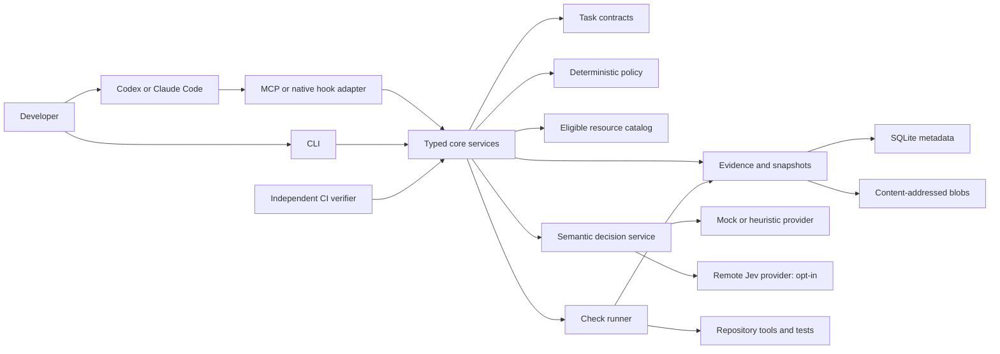

# Architecture

This is the broader design. See [current status](../status.md), the
[reconciled post-MVP report](../research/harness-validation-consolidation.md) and
[completion schema 2](../reference/completion-diagnostics.md) for the implemented
candidate slice. Proposed components here are not proof of installed capability.

Status: proposed; see [ADR index](../adr/README.md).

## Components



The core owns task identity, policy, evidence validation, budgets, and completion aggregation. Adapters translate host payloads. Provider modules translate bounded questions and validate answers. Neither adapter nor provider may implement a separate readiness algorithm.

## Proposed implementation layout

```text
src/
  core/           task-service, routing-service, review-service, completion-service
  contracts/      versioned schemas and inferred types
  catalog/        normalized skill and agent metadata
  policy/         applicability and deterministic aggregation
  evidence/       snapshot, runner, blob store
  storage/        SQLite repository and migrations
  providers/      interface, mock, heuristic, jev
  adapters/       mcp, cli, codex, claude-code, ci
  installer/      preview, ownership manifest, doctor
tests/
  unit/
  integration/
  contracts/
  fixtures/
evals/
  datasets/
  protocols/
  results/
packaging/
  plugins/
```

These are logical module paths, not present files or a final language-specific layout. One package initially keeps distribution and releases simple. [ADR-0001](../adr/0001-runtime-and-adapters.md) now evaluates Python first, comparing LangChain's Jev integration with the direct Python SDK and retaining TypeScript/Node 24 as an alternative. The Python MCP SDK provides a candidate STDIO adapter. Pin exact runtime/package versions and choose the physical layout after the [compatibility comparison](../research/python-langchain-assessment.md). LangGraph and hosted LangSmith are optional, not core dependencies. Validation at runtime still governs external inputs.

## Core operations

| Service | Operation | Persistent effects |
|---|---|---|
| Task | startTask / reviseTask | Contract, immutable revision, session mapping |
| Routing | route | Decision record, usage accounting |
| Checks | runChecks | Snapshot, runs, logs, provenance |
| Review | review | Semantic findings tied to evidence and rubric |
| Completion | complete | Snapshot-bound report from stored evidence/findings; no implicit check or provider execution |
| Hook coordination | reserveContinuation | Atomic event deduplication and budget reservation |

MCP exposes five tools over these services; revisions can use the task-start tool with explicit revision preconditions. CLI lifecycle commands may expose additional local administration operations. Hook control is adapter-internal, not a general execution tool.

## Process and storage boundaries

MCP and hooks may run in separate short-lived processes. They share a local SQLite database and blob store under an OS user-data directory. Repository config and policy remain declarative. WAL mode, busy timeouts, transactions, migrations, and platform packaging must be tested before choosing a SQLite binding.

The database stores small records and references. Blobs hold bounded command output and evidence fragments. Write blobs atomically, verify digests on read, and commit references transactionally. An interrupted write may leave an orphan blob; it must never create a successful run record.

A database path outside the checkout is operational separation, not tamper resistance against the same OS account.

## Dependencies and failure isolation

Core services depend on interfaces for storage, clock, command execution, catalog discovery, and providers. They never import MCP or host payload types. Logging goes to stderr for STDIO processes; protocol output alone goes to stdout.

Provider errors become unavailable semantic results without destroying valid mechanical evidence. Storage corruption, missing policy, schema mismatch, or identity ambiguity return explicit errors or unresolved reports. Unknown host capabilities disable the corresponding automation.

## Deferred architecture

HTTP serving, a shared daemon, remote storage, cross-machine state synchronization, multiple published packages, and fine-grained invalidation require separate ADRs. The first measurements should identify whether any of those solve a real bottleneck.

See [contracts](contracts-and-evidence.md), [workflow sequences](workflows.md), and [trust boundaries](security-and-privacy.md).

