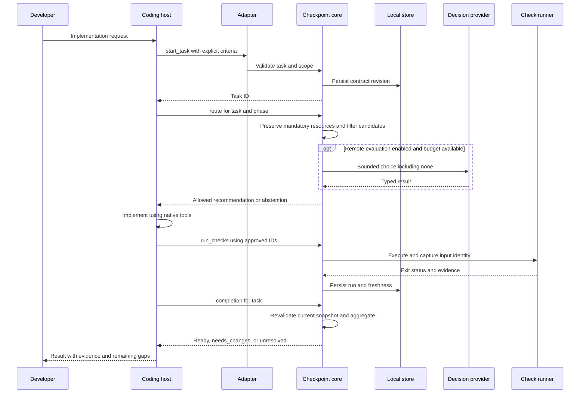
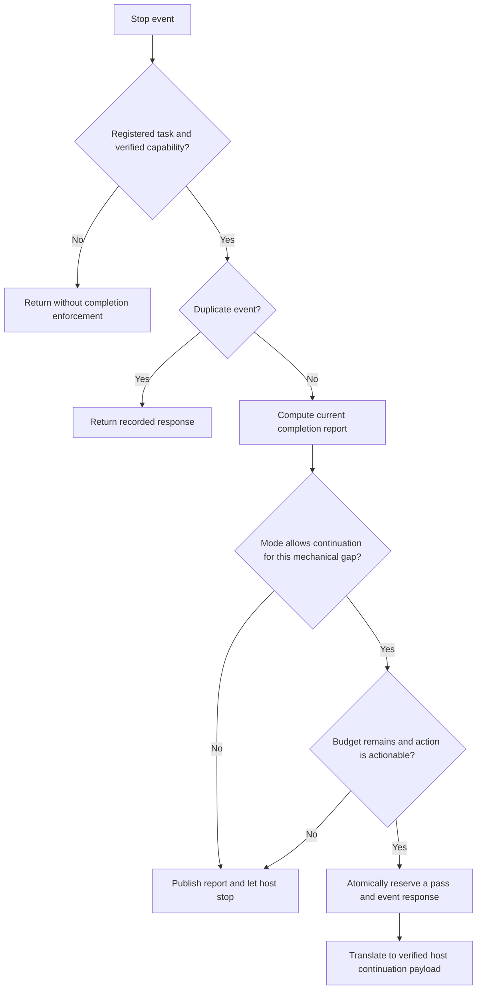
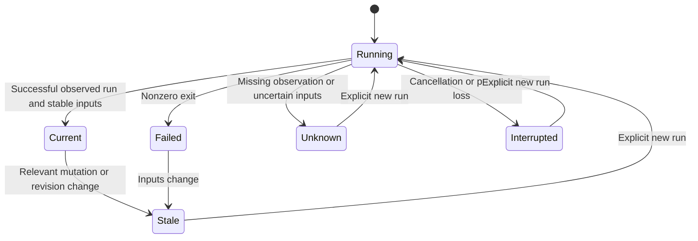
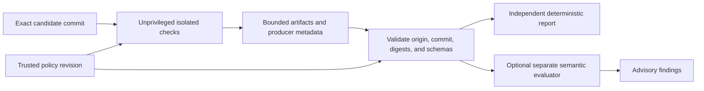

# Interaction workflows

Status: proposed sequences. Host event names are integration candidates until the compatibility spike passes.

## Explicit task through MCP or CLI

Completion does not implicitly run checks, install dependencies, or edit code. Suggested next actions are constrained identifiers and templates, not provider-generated shell commands.

## Native stop adapter

Missing credentials, ambiguous user requirements, unsupported capabilities, and semantic uncertainty are not repaired by repeatedly asking the agent to continue. Report them. A provider outage does not spend remediation passes. Observation permits zero continuations; an explicitly enabled mechanical pilot permits at most one across the task.

## Evidence lifecycle

Old records remain for audit. Re-running creates a new record; it never edits a historical failure into a pass.

## Independent CI

CI must establish its own task/commit context and rerun required verification. Importing a local ready report is not independent verification. An exported local artifact is comparison data until its provenance is established.

