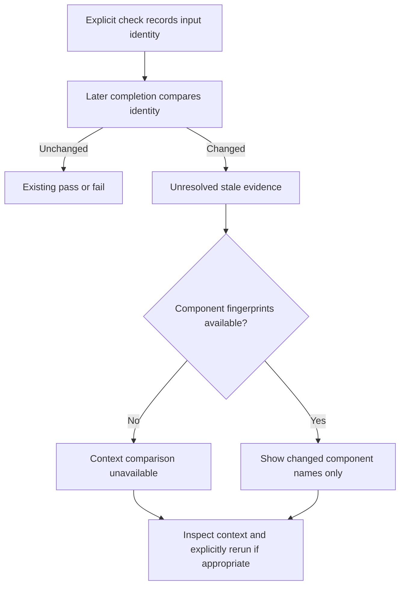

# Stale execution-context diagnostics (candidate 0.1.7)

Completion still requires unchanged evidence inputs. A changed launch environment
must not be waved through because the source files look identical. Use the same
supervisor/transport for check and completion, or explicitly rerun under the desired
context using a new request ID after inspecting the discrepancy.

New check records retain fixed SHA-256 fingerprints for five context components:
definition, filtered environment, Python runtime, resolved check executable, and
launcher. No environment values, executable paths or source content are added to
these records. Fingerprints are local comparison metadata, not anonymization or
attestation; do not upload raw records implicitly. Existing snapshot identity and
freshness conditions are unchanged.

For stale evidence, completion adds `stale_diagnostics` with check/run IDs, an
allowlisted changed-component list, context comparison `changed`, `unchanged`, or
`unavailable`, and `workspace_generation_changed`. The latter compares file metadata,
not every possible workspace input. An unchanged context is not proof that source
is unchanged; Git index/base changes can also stale evidence. Legacy records lacking
component fingerprints return unavailable, not an invented cause. Missing/corrupt
evidence retains existing unavailable behavior. Policy/definition changes can still
fail earlier with POLICY_CHANGED. Diagnostics do not run checks or grant authority.
Unknown or partial context layouts likewise make component comparison unavailable;
they do not crash or bypass the full snapshot-based freshness comparison.

The read-only report and dashboard show sanitized historical diagnostics. They
never recalculate them; a report of an earlier context mismatch is not current
readiness. Invalid diagnostic records are omitted from the projection. Pinned 0.1.2
cannot emit these new diagnostics and has not been replaced.

## Controlled replay

Run `scripts/context_diagnostic_probe.py` with a separately installed interpreter
under `-I`, providing a fresh external `--output` path. The probe creates a temporary
Git workspace and disabled-provider state. One explicit check passes; changing a
synthetic LANG value makes completion unresolved without executing another check.
Old 0.1.6 only says EVIDENCE_STALE. Candidate 0.1.7 additionally identifies environment
when verified. It never proves what caused the earlier real native/CLI mismatch;
that historical state lacks component evidence. Do not mislabel the replay as a
root-cause determination of the host discrepancy.

