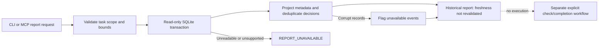

# Read-only history reporting (candidate 0.1.5)

Use this for diagnosis and dashboard polling, not as a substitute for completion.
The active pinned 0.1.2 supervisor still exposes five tools; it does not gain a sixth
tool by editing candidate source. Promotion and host reload are separate operations.

## CLI

From this repository, inspect the separate website's recorded state:

```powershell
uv run --locked --offline --extra jev python -m agent_checkpoint `
  --root D:/Programming/project-garden-lab `
  --state C:/Users/juanf/AppData/Local/agent-checkpoint/harness/garden-lab/state `
  report --task 809c7c3777cdec26924d292efe0e1759 --limit 100
```

Omit `--task` to list tasks. This candidate read-only inspection is not candidate
self-supervision. It does not create tasks, approve changes, run checks, refresh
completion, or call providers. `--config` is not read by the report path: recovery
reporting remains available with malformed configuration. State must already exist.
An independently installed candidate Python can run the same command with `-I`.

## MCP

Candidate `checkpoint_report` accepts optional task_id and limit (integer 1–200).
It publishes a validated Report/error output schema and read-only, closed-world
annotations. An initialized Runtime's report call bypasses policy/provider execution.
Starting the MCP server still performs the ordinary runtime initialization; the CLI
report path additionally bypasses that initialization entirely.

## Interpret the report correctly

- `readiness: not_revalidated` always. `last_recorded_completion` is historical,
  may refer to an older revision, and can be absent from the returned window.
- Task revisions and event sequence establish identity/order, not timestamps.
  Legacy timestamps and producer version are null; reporter version is not producer identity.
- `events` contains safe metadata projections, not raw source, request/criterion
  text, environment values, output blobs, commands, or provider response bodies.
  IDs are metadata, not a place to store secrets. Free-text IDs are replaced with
  opaque aliases; aliases are diagnostic labels, not input task IDs.
- Provider metrics deduplicate decision_id across decisions, routes and reviews.
  Conflicting duplicate metrics count as unknown. Known subtotals are not complete
  totals when unknown counts, unavailable events, or truncated windows exist.
- `budget_reserved_calls` is the stored task-wide reservation count, distinct from
  observed physical requests in this window. It is not billing reconciliation.
- Dollars remain null. No p95, quality score, savings or success-rate claim is inferred.
- Suggested historical actions carry no execution authorization.

## Bounds and recovery

Queries are scoped by worktree and task in one read transaction; SQLite opens
mode=ro/query_only. Reporting never constructs a Store or migrates a database.
Task/event results are limited to 200, event payloads to 64 KiB characters, exports
to 1 MiB, SQLite lock wait to 1 second, and query work to ~2 million VM operations.
Unsupported schema/query failures return REPORT_UNAVAILABLE. Corrupt, oversized
or foreign-bound event payloads increment unavailable_events instead of leaking text.
Truncation flags distinguish omitted history from an empty history.

If unavailable, preserve state and inspect installation/state paths manually.
Do not automatically recreate the store or rerun checks. Direct checks remain usable.



Candidate 0.1.6 adds the [local dashboard](local-dashboard.md) and timestamped operation
events. Older records remain timestamp-unknown; report reads still append nothing.
