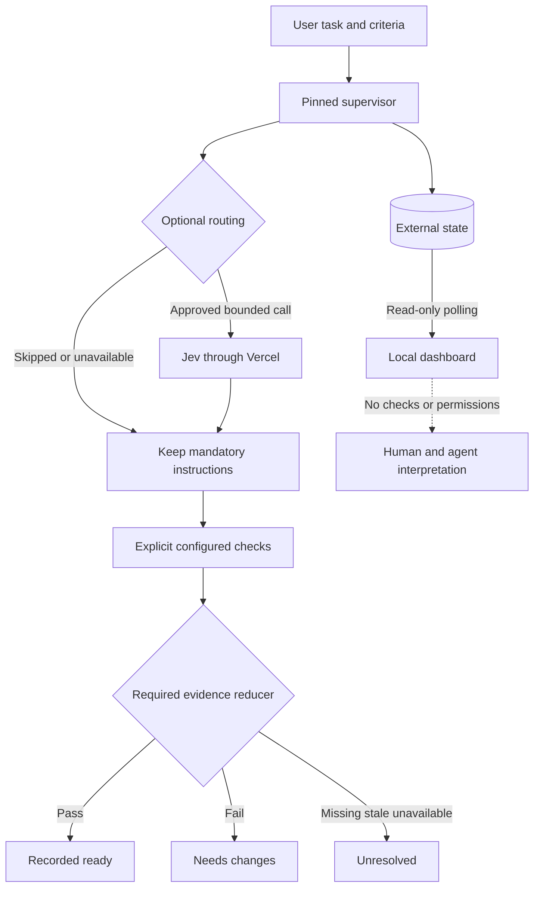

# Local observatory (introduced in candidate 0.1.6)

This viewer is read-only. It can inspect pinned 0.1.2 history without promoting the
candidate or rewriting active state. Hosted Langfuse/telemetry is not connected.

## Start and stop

Once the separately validated candidate-iteration-3 installation exists:

```powershell
& C:/Users/juanf/AppData/Local/agent-checkpoint/harness/garden-lab/candidate-iteration-3/venv/Scripts/python.exe `
  -I -m agent_checkpoint --root D:/Programming/project-garden-lab `
  --state C:/Users/juanf/AppData/Local/agent-checkpoint/harness/garden-lab/state `
  dashboard --port 4174 --source-role pinned_supervisor --producer-version 0.1.2
```

Open the **full URL printed by the command**, including its temporary fragment token.
The page removes the token from the address bar and retains it only in page memory.
Reloading needs the original URL again. Do not publish or save session URLs in docs.
No Gateway credential is needed or loaded. Port 0 (default) selects a free loopback port.
Stop with Ctrl+C in the owning terminal. No service, recurring job or host-global
configuration is installed. Candidate source can also run this command using uv,
but it is a viewer, never the active supervisor.

For the Checkpoint repository's history use its root and pinned 0.1.2 state path.
For candidate experiments use disposable fixture root/state and source-role
candidate_fixture. Source identity flags are explicitly **operator declarations**,
not cryptographic attestation. The reporter version and per-event producer version
are displayed separately; legacy event producer identity remains unknown.

## Reading the interface

- Tasks are identified by IDs instead of private request text. Match iteration IDs
  using the six loop reports. A friendly iteration-label catalog is not implemented.
- Polling reads every two seconds; pause/resume is explicit. A failed read keeps the
  last good report with a stale-data warning. Polling never calls completion, checks,
  routing or a provider.
- Last recorded completion is historical, even when it says ready. Check activity
  after completion is flagged. A start without finish is not proof a process is alive.
- The native decision overview highlights observed branches. The expandable and
  downloadable **Mermaid source** expresses the lifecycle/authority branches using
  fixed labels, not untrusted report strings. No CDN or Mermaid renderer is loaded;
  the overview is rendered with local HTML/CSS, and .mmd can be rendered separately.
- Check obligations/reasons and typed historical actions appear beside the trace.
  Actions never grant execution permission. Pinned 0.1.2 may have no typed actions.
- Trace filtering, metadata JSON and Mermaid exports contain no raw source, check
  output blobs, request text, environment values or tokens. IDs are metadata and
  should never be used to store secrets. Downloads are user-initiated browser actions.
- Known token/request subtotals, unknown counts, budget reservations and billing are
  distinct. Window truncation and unreadable events remain visible. No savings or
  coding-performance score is inferred.

## New operation traces

Candidate 0.1.9 reuses task buttons on unchanged polls. When tasks reorder it
restores the same focused button without scrolling; if that button disappears from
the bounded list it focuses Pause/Resume polling. Focus outside the task list is
left alone. Keyboard polling regressions run offline through pytest using Node.js;
the installed UI is also checked in a real browser. This is not supervisor promotion.

Candidate 0.1.8 adds window-local start/finish associations. Trace rows say recorded
start and identify a matching finish sequence, or explicitly say the counterpart
was not observed in the returned window. Duplicate/reversed or conflicting
associations are ambiguous; missing association metadata is unavailable. No extra
history query is made to fill the window. Check and operation IDs are paired
separately, with matching revision and operation/check identity. Unknown starts do
not get a zero-duration measurement fabricated from legacy default fields. Raw
stored status/reason remains unchanged and visible in JSON. None of these labels
establishes process liveness or changes readiness. Source timestamps remain unknown
where they were not recorded.

The startup example above intentionally keeps the verified 0.1.6 viewer path.
For later separately validated viewers, choose their installed interpreter from
the iteration validation manifest. This is not supervisor promotion.

Candidate Runtime records operation start/finish, UTC timestamps, monotonic duration,
operation ID, transport, producer version and contract revision. Task creation emits
a finish event after registration; it includes its earlier start timestamp. Calls
rejected before a valid task association have no task trace. Interrupted processes
can leave starts without finishes; pending replay responses are recorded as pending.
Repeated calls may produce additional call traces, not additional provider usage.

Report reads are excluded from tracing, preventing recursive polling writes.
Trace-write failure emits a sanitized stderr warning and does not alter the core
result or mask its exception. Trace completeness is therefore not guaranteed.
No legacy timestamps are fabricated. These new records occur in candidate state;
the installed active 0.1.2 supervisor is unchanged.

## Security and limits

Only 127.0.0.1 binds. Exact Host, same-origin Origin/Sec-Fetch-Site checks and a random
session capability protect the API. Duplicate Host/Origin headers are rejected.
Only GET serves data; static paths are allowlisted. No CORS, external assets, raw
filesystem path parameters or mutation endpoints. CSP blocks inline scripts, frames
and object content; responses are no-store and nosniff, request logging is disabled.
Eight concurrent connections and five-second socket deadlines bound the small
stdlib server. SQLite/query/export limits are described in the reporting guide.
This is a local developer viewer, not a hardened public deployment server.

## Decision boundaries


