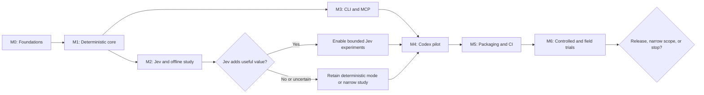

# Roadmap

Historical product milestone map. Current execution follows the
[post-research adjustments](post-research-adjustments.md); see [status](../status.md)
for active 0.1.2 versus candidate 0.1.3. This map is not an implementation inventory.

Status: planned; all implementation milestones are open. This is dependency order, not a calendar estimate.

## Development harness track

The [Codex harness and self-adoption roadmap](self-adoption-roadmap.md) runs alongside product delivery. Begin with native Codex and independent verification, use the first validated deterministic build in shadow mode, then introduce explicit advisory calls and optional verified hooks. A pinned build N may assist development of N+1; independent checks still govern promotion.

Its HARNESS tasks are separate from the product TASK IDs below. Early internal use need not wait for the entire product release, and adopting Jev is conditional on evidence. The research response is captured in the [consolidation notes](../research/revised-plan-consolidation.md) and proposed [bootstrap runbook](../runbooks/development-harness.md).

## Milestones

| Milestone | Outcome | Tasks | Exit gate |
|---|---|---|---|
| M0: foundation decisions | Python-first runtime comparison, selected scaffold, data boundary, schemas and pure readiness reducer | 01–04 | Runtime choice recorded; direct commands work without Checkpoint; evidence authority and domain fixtures pass |
| M1: deterministic runtime | Durable evidence and truthful readiness through local services | 05–08 | Identity/freshness/failure fixtures pass without network |
| M2: provider research | Bounded Jev adapter and offline comparison | 09–10 | Reproducible results identify whether Jev merits further use |
| M3: explicit vertical slice | CLI and five MCP tools usable in target hosts | 11–12 | Same fixture task produces equivalent results across interfaces |
| M4: Codex automation pilot | Observe hooks first, then optional one-pass mechanical continuation | 13–14 | Restart/duplicate/unknown-capability tests and a live demo pass |
| M5: distribution and verification | Independent CI, reversible installation, Claude native spike | 15–17 | Trusted CI evidence and tested installation/compatibility records |
| M6: measured release decision | Controlled trials and observe-only field results | 18–19 | Pre-registered product gates met or documented scope reduction |
| Future | Expanded intervention types or deployment | 20 | Separate evidence and ADR for each expansion |

Tasks 11–12 can proceed after the deterministic core while offline provider experiments run independently. Jev research is not a prerequisite for deterministic-only usefulness. Native hook investment should wait for the M2 analysis and M3 explicit workflow.

## Scope of the first reviewable slice

The first engineering package is H0/M0: native Codex guidance, task/handoff templates, a scaffold selected through the [Python-first comparison](../research/python-langchain-assessment.md), domain schemas, mock fixtures, and a pure readiness reducer. TASK-07 later integrates it with persistent current evidence. The next smallest executable unit is task → snapshot → one approved check → edit → stale evidence → unresolved report.

A small API task moves through explicit registration, real skill selection or abstention, approved check execution, evidence review, and completion. Start with mock and deterministic providers. Add Jev with opt-in, then the host pilot.

This slice excludes architecture scoring, model switching, arbitrary tool screening, and a hosted control plane.

## Release tiers

Research prototype means repeatable fixtures and evaluations. Advisory preview adds a supported installation and explicit MCP workflow. Native-hook preview adds individually tested events with opt-in continuations. A stable release requires reproducible compatibility and product evaluation, operational recovery, and truthful manuals.

Shipping these docs completes design consolidation only. It does not complete any runtime milestone.

## Planning effort from the revised research

The report estimates M0 through M6 at 3–5, 6–10, 3–5, 4–7, 5–8, 5–8, and 6–12 developer-days respectively: 32–55 days of effort in total before future expansions. These are unscheduled estimates for one experienced developer, not delivery promises or measured throughput. The first week should target the bootstrap and a small deterministic evidence slice; refine estimates after TASK-03/04 rather than committing to hooks or Jev immediately.

