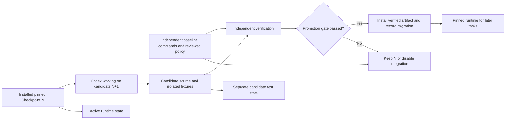

# Codex harness and self-adoption roadmap

Current sequencing is in [post-research adjustments](post-research-adjustments.md).
Active self-use is pinned 0.1.2, candidate 0.1.3 is unpromoted, and routine review is
opt-in. The historical H0/bootstrap descriptions below are not current-state claims.

Status: proposed adoption track, 2026-09-27. No harness setup or runtime integration has been implemented by this documentation change.

Implementation update: this page retains the broader proposed roadmap. The internal
MVP now has active guidance, direct checks, pinned shadow plus two real advisory
self-use tasks, installed CLI/MCP verification, matched measurements and a copied-
state promotion/rollback drill. See the [audited report](../reports/mvp-validation-report.md).
Hooks and routine production adoption remain unimplemented; the original broad
HARNESS acceptance criteria are not automatically satisfied by this smaller goal.

Purpose: build Agent Checkpoint with a useful Codex workflow now, then use independently validated versions of Checkpoint to assist later development of the same repository.

The [Deep Research prompt](../research/prompts/codex-harness-deep-research.md) has produced a [revised report and consolidation](../research/revised-plan-consolidation.md). This roadmap incorporates its design refinements; installed-host and product tests are still pending. The existing [product backlog](backlog.md) remains authoritative for product implementation.

## Baseline and authority

The bootstrap consists of native Codex, concise repository guidance, explicit task acceptance criteria, direct verification commands once they exist, and independent review. It does not require our future runtime, Jev, MCP server, or hooks.

Maintain that baseline throughout adoption. Installed Checkpoint version N can help build candidate N+1, but the candidate cannot certify its own promotion by returning ready. No self-adoption status implies public release readiness.

## Adoption stages

| Stage | Entry condition | Use in this repository | Exit evidence | Rollback |
|---|---|---|---|---|
| H0: bootstrap | Current docs-only state | Define task briefs, instructions, handoffs, direct verification and baseline measurement | First scoped change independently checked; bootstrap remains usable without Checkpoint | Native Codex and manual task/check records |
| H1: deterministic shadow | TASK-05–08 and TASK-11 validated; independently packaged prototype | Run pinned prototype explicitly on selected tasks after normal work; results are not supplied to the active implementation agent | Compare reports with actual command results/review; test stale evidence and failure cases | Omit prototype invocation |
| H2: explicit advisory use | H1 invariants and fallback pass; TASK-12 for MCP path | Developer/agent calls pinned CLI or MCP for task, route, check, and completion | Task identity, current evidence, and useful guidance without regressions | Disable MCP entry; use direct commands |
| H3: optional Jev advice | TASK-02/09/10 and repository data approval | Selected bounded questions within budgets; retain deterministic mode | Incremental benefit over deterministic/heuristic/self-judge conditions, with uncertainty | Disable remote provider; retain local workflow |
| H4: native hook observation | H2, TASK-13, verified host contracts; H3 optional | Collect reports without changing agent actions; later advisory use is a separate condition | Coverage, lifecycle, restoration, and overhead measured | Disable specific integration outside Checkpoint |
| H4b: mechanical continuation | H4, TASK-14, independent checks | Explicitly enabled mechanical pilot with at most one task-wide pass | Restart, dedupe, cancellation, recursion and hard-cap fixtures pass | Disable hook registration outside Checkpoint |
| H5: routine controlled adoption | Independent CI or equivalent stable verification, promotion/rollback drill, packaging integrity | Promote pinned builds deliberately and use N to assist N+1 | Repeated task evidence plus independent release checks; accurate usage manual | Restore prior integration, binary, and compatible state |

“Shadow” must mean recommendations cannot affect the active agent's actions; otherwise label the condition advisory. Start with synthetic or approved local fixtures and provider disabled. H3 is not a prerequisite for deterministic-only H4.

Early internal adoption may use a verified local build artifact; it need not wait for public packaging or the full M6 field trial. Record the build source revision and hash, and label it an internal prototype.

## Version and trust separation

Use distinct locations for installed runtime, candidate checkout, active runtime data, and candidate test data. A diagram arrow is an operational relationship, not proof of security isolation.

A promotion record should contain artifact/source identity, runtime/dependency versions, host compatibility, policy revision, schema migration, independent checks, known limitations, rollback artifact, and state-restoration procedure.

Do not run a live rebuilt working-tree entrypoint as the trusted hook while editing that hook. Candidate-specific experiments run explicitly in disposable contexts.

## Promotion and escape procedure

1. Build the candidate into a distinct artifact with a recorded source revision/hash.
2. Run direct independent checks and candidate fixtures using separate state.
3. Review modifications to acceptance rules, policies, tests, hooks, and promotion machinery.
4. Test compatibility with current host and relevant stored-state schemas.
5. Back up a consistent state snapshot before any migration; confirm that the previous binary can use its rollback state.
6. Switch the pinned integration only after verification; run a bounded smoke test.
7. On regression, disable integration through the host/manual configuration path and restore the prior artifact plus compatible state.

Rolling back only the binary is insufficient after an irreversible database migration. Do not point N at N+1's upgraded database without validated compatibility. Preserve newer records separately when restoring a backup, and disclose any gap rather than merging records blindly.

The escape path cannot depend on Checkpoint's CLI, provider, or database being healthy. Disabling it must preserve baseline type/test/build commands and normal host permissions. It cannot relabel unresolved work ready.

Checks that exercise Checkpoint itself must use isolated fixtures or explicitly suppress the optional integration at the host boundary. Prevent recursive hook execution and duplicate test runs.

## Migration map

| Bootstrap mechanism | Future use of Checkpoint | What remains independent |
|---|---|---|
| Human-readable task brief | Explicit versioned task contract | Original user request and review of inferred criteria |
| Small skill shortlist | Optional validated routing | Mandatory instructions and user-requested skills |
| Direct script execution plus saved results | Approved runner and scoped evidence | Ability to invoke authoritative checks directly |
| Manual current-diff/check comparison | Snapshot-aware completion report | Independent invariant tests and release verification |
| Manual gap/rework record | Structured findings and telemetry | Independent outcome labels and hidden evaluation data |
| Explicit end-of-task checklist | Optional validated stop hook | Manual completion and bypass path |
| Local handoff note | Exported task/evidence references where useful | Human-readable recovery context |
| Fixed baseline measurements | Versioned experiment records | Analysis that includes failures and intervention overhead |

Retire duplicate wrappers only when their replacement is proven. Avoid retaining two separate readiness algorithms. Independent checks are deliberately retained; duplicated orchestration is not.

## Harness task backlog

These HARNESS IDs describe development-process work. They do not renumber or mark done any TASK IDs in the product backlog. Owner roles are not assigned people.

| ID | Priority | Dependencies | Proposed deliverable | Acceptance |
|---|---|---|---|---|
| HARNESS-01 | P0 | None | Deep Research findings and current Codex capability record | Native CLI/app/programmatic surfaces, Windows limits, and fallbacks distinguished with sources |
| HARNESS-02 | P0 | HARNESS-01 | Proposed AGENTS.md, task/handoff templates, concise repo map, operating runbook | One real work package can start/resume without Checkpoint; guidance points only to existing commands or clearly pending setup |
| HARNESS-03 | P0 | HARNESS-02; TASK-03 as commands become available | Direct verification manifest and baseline measurement protocol | Commands demonstrably run without Checkpoint; failed attempts and human effort are recorded |
| HARNESS-04 | P1 | HARNESS-03; TASK-05–08/11 | Pinned deterministic prototype, separate state, shadow-trial report | Stale/fabricated evidence and corrupted-store fixtures cannot create pass; outputs do not influence shadow tasks |
| HARNESS-05 | P1 | HARNESS-04 | Promotion record, state backup/restore plan, manual escape drill | Broken runtime and incompatible migration can be recovered without Checkpoint; direct checks still run |
| HARNESS-06 | P1 | HARNESS-05; TASK-12 for MCP | Explicit advisory adoption on selected tasks | Identical fixture meaning across CLI/MCP; no silent active-version update; impact measured |
| HARNESS-07 | P1 | HARNESS-06; TASK-02/09/10 | Optional Jev trial and budget/data policy | Comparative evidence justifies the selected questions or records decision to keep Jev disabled |
| HARNESS-08 | P1 | HARNESS-06; TASK-13/14 | Hook observe pilot and optional bounded mechanical continuation | Dedupe/restart/cancel/recursion and manual-disable tests pass; semantic-only gaps never force continuation |
| HARNESS-09 | P1 | HARNESS-05/06; TASK-15/18; HARNESS-08 if hooks adopted | Adoption review, pinned-version cadence, external evaluation plan | Internal feedback separated from held-out release evidence; duplicate bootstrap wrappers retired selectively |

All tasks remain open. HARNESS-01 now has a consolidated research input but lacks installed-surface checks. HARNESS-02 has documented templates and a proposed runbook; active instructions and actual bootstrap commands are still unimplemented. Do not mark these tasks complete merely because their document drafts exist.

## Metrics and stage gates

Before the first implementation task, record the task definition, baseline host/model, start/finish boundaries, and independent outcome. Once available, add model/provider usage, verification time, retries, interventions, first-ready claim, and later corrections.

Compare unchanged tasks and host settings where possible. Record repository maturity and task type; simple chronological improvement is not proof of intervention value. Charge setup/maintenance work and checkpoint overhead to the adoption assessment.

Set quality, latency, spend, and interruption thresholds before each pilot. Exact thresholds await HARNESS-01/03 and measured baselines. Any invariant violation, unexpected recursion, secret exposure, or unusable escape path stops the affected integration regardless of average performance.

Self-development tasks are useful feedback but are not a held-out benchmark. Keep separate tasks/repositories for claims about general coding-agent performance; follow the existing [evaluation protocol](../research/evaluation.md).

## Immediate next action

Use the [consolidated findings](../research/revised-plan-consolidation.md), [runbook](../runbooks/development-harness.md), and [verification inventory](../verification.md) to prepare H0 and TASK-03/04. Product foundation checks can proceed while later adoption questions remain open. No Checkpoint installation is a prerequisite for building the first version.

