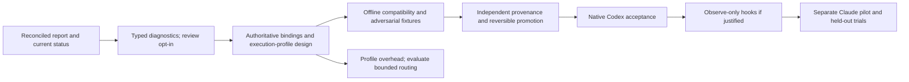

# Harness validation report: reconciled decisions

Consolidated: 2026-09-27, following explicit user authorization to consolidate and
begin adjustments. [Supplied report](sources/2026-09-28-harness-validation-report.md)
labels itself 2026-09-28 and analyzes the 2026-09-27 activation. Its supplied date is
preserved, not independently established. Source citation tokens are retained as
historical text; they are not functioning source references or verified claims.

## Decision

Keep the deterministic task/evidence core central. Use Jev for bounded advisory
routing, and make completion review an explicit experiment rather than a default
call. Improve diagnostic usefulness now, then establish authoritative binding and
execution-profile contracts before broader automation. Retain direct Python and
Gateway-only transport; no LangChain/LangGraph migration is justified by this report.

This accepts a direction, not every schema, deadline, configuration example or
external claim in the report. Only the first bounded slice is implemented here.

## Reconciliation against code and observed behavior

| Report recommendation / concern | Repository evidence | Resolution |
|---|---|---|
| Add payload-bound replay | storage.claim_request already hashes payload and rejects IDEMPOTENCY_CONFLICT; runtime includes revision and review snapshot | Keep and expand tests, not a new subsystem |
| Add immutable revisions | storage already rejects weakening, scope/request changes and conflicting revisions | Authentication of who approved the original criterion remains open |
| Add criterion/evidence bindings | Criterion.check_ids already expresses a binding; reducer only uses bound checks | Missing piece is authoritative semantic suitability and richer evidence obligations, not any binding at all |
| Add MCP outputSchema | All five tools already advertise a generic object | Candidate strengthens completion first; four detailed output contracts remain follow-up |
| Move pinned launcher out of checkout | Project MCP already targets an external pinned .mjs; CLI convenience .ps1 and project config remain editable | Record exact trust chain; do not claim the bootstrap itself was repo-local or that hashes create a privilege boundary |
| Canonical execution identity | runner.check_context/check_environment already shared across transports | Formal profile/digest and declared identity inputs remain to design; retain PATH/PATHEXT where executable resolution depends on them |
| Credential outside candidate | Bootstrap currently loads repo .env.local; snapshot exclusion is not access control | Migration requires an explicit operator procedure; do not read/move the secret during this slice |
| Disable routine review | Real status-only reviews returned insufficient; no demonstrated review value | Adopt procedural opt-in; retain API and approved scope for experiments |
| Add typed next actions | v0.1.2 emitted only inspect_required_evidence | Implement candidate schema 2 diagnostics; no executor or automatic replay |
| Clean CI/promotion | Direct local checks and disposable drill exist, independent hosted CI does not | Design next; no push, hosted setup, branch protection or fabricated CI success |
| 70% overhead reduction / sub-second p95 | No measurements substantiate those targets | Treat as provisional hypotheses; profile before committing thresholds |
| Hooks / Claude | Config parsing and standalone MCP do not prove native invocation | Native Codex acceptance before hooks; separate Claude gate |

Local inspection basis: contracts.py, storage.py, runner.py, service.py, runtime.py,
mcp_server.py, .codex/config.toml, scripts/checkpoint.ps1 and the prior activation
record. Current source is candidate 0.1.3; active runtime stays pinned to 0.1.2.

## Authority and safety refinements

The report's authority ladder mixes requirements, policy and evidence. These are
different concepts: user/repository authority defines obligations; observations
support them. A manual attestation cannot override a failed required check, and a
high-confidence semantic finding cannot turn an unknown into an authoritative pass.

A request digest establishes identity, not authenticated user approval. An authority
string has the same problem as origin unless its producer and approval path are
defined. Test names/assertion IDs are also not proof of semantics by themselves.
The next design must specify who can approve bindings, how tests are selected and
observed, and how changes affect those approvals. See ADR-0010.

We do not adopt the example replay_safe:true hint. Approved checks can have side
effects; stale or interrupted does not make rerunning safe. Diagnostics identify
the gap, while the host/operator retains permission, process reconciliation and
new request-ID decisions. No commands are embedded in next_actions.

## Verified versus unresolved external claims

Checked the [MCP 2025-11-25 tools specification](https://modelcontextprotocol.io/specification/2025-11-25/server/tools):
output schemas describe structured results; provided schemas require conforming
structured results. This supports strengthening the existing schema, not adopting
a new protocol version. Current code remains pinned to the tested MCP SDK.

Do not import the report's new Codex approval keys, lifecycle event list, newest MCP
version, provider model/version guarantees, prices, retention assertions or exact
Claude timeout behavior as runnable facts. Their exported citations lack URLs.
Some prior source-register entries have related checks, but account-specific terms
and installed-host compatibility remain separate. Recheck primary sources in the
work package that uses each claim. No new privacy, billing or ZDR guarantee is made.

## Adoption sequence

This is dependency guidance, not a calendar commitment. Native read-only acceptance
can be investigated earlier; enforced lifecycle behavior cannot bypass these gates.
Automatic continuation, semantic blocking and richer remote evidence stay deferred.

## Research outcome

The report gives a useful evidence-first direction, but does not establish coding
benefit, authenticate contracts, prove a security boundary or supply a migration.
The [adjustment roadmap](../planning/post-research-adjustments.md) defines what is
implemented, what remains proposed and what evidence each next step must produce.
