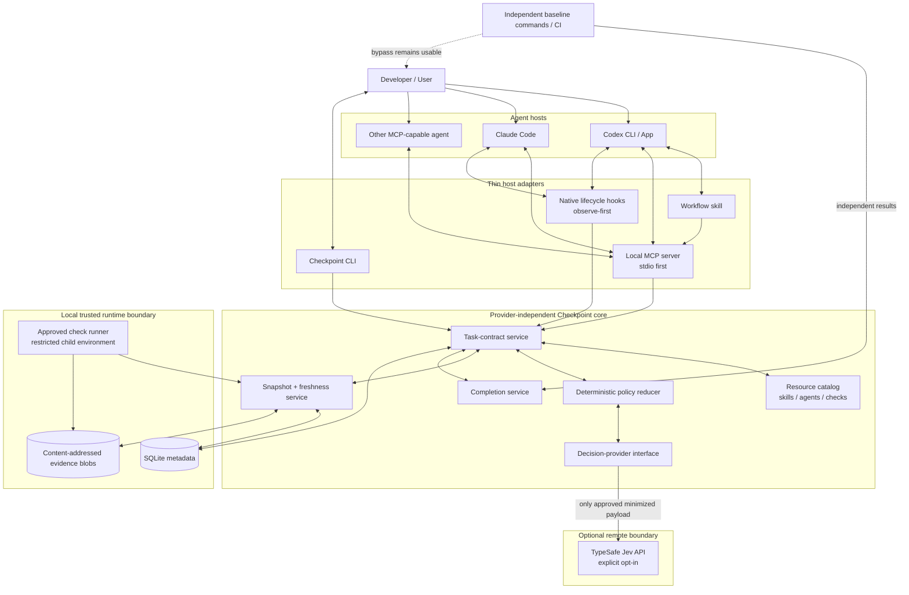
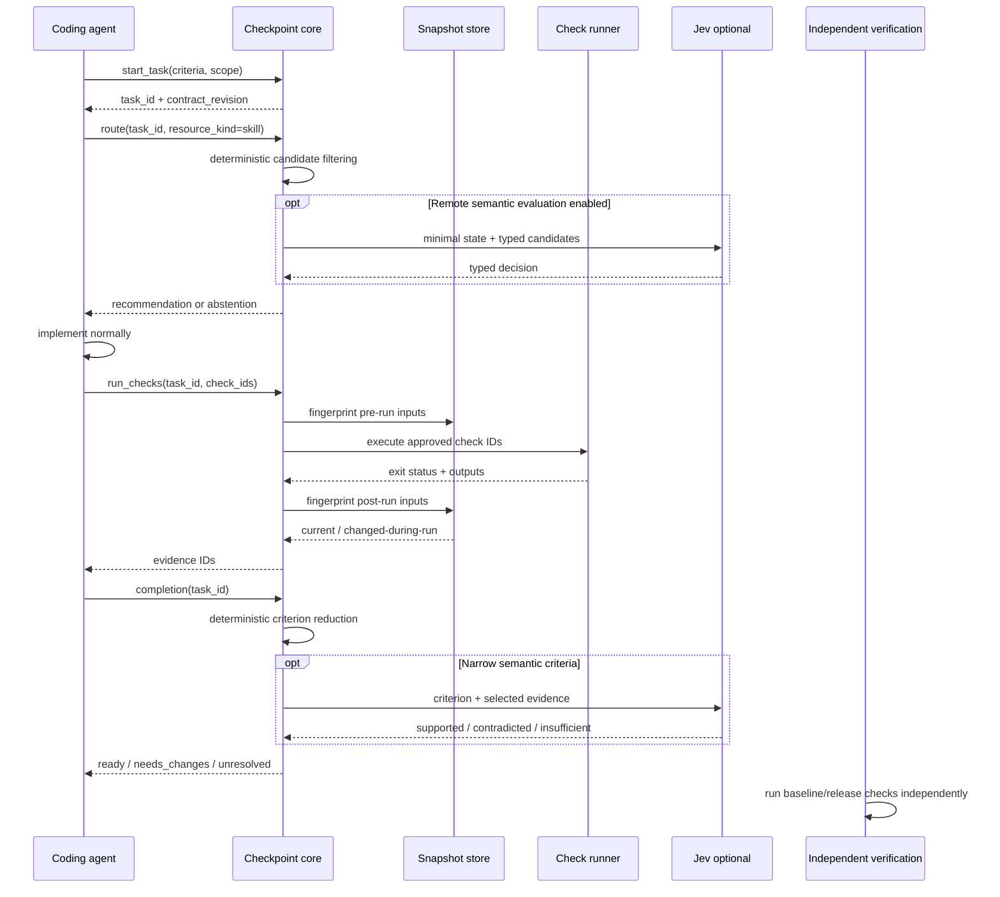
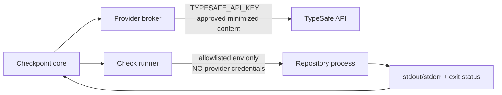
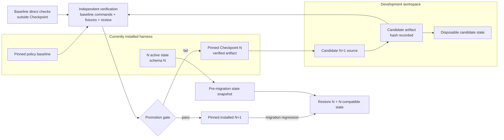
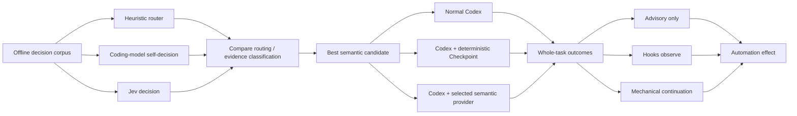

# Agent Checkpoint: Revised, Source-Grounded Engineering Plan

**Research snapshot:** September 27, 2026  
**Status:** engineering-ready design; no repository code, local Codex installation, Jev account, hook behavior, or Windows process-runner behavior was executed as part of this research.

The supplied materials already establish the right core idea: keep Agent Checkpoint provider-independent, separate claims from recorded evidence, expose one core through CLI/MCP/hooks, preserve `unknown`, and prevent candidate version N+1 from certifying itself. fileciteturn0file2 The self-adoption roadmap also correctly separates installed Checkpoint N from candidate N+1 and preserves an independent bootstrap path. fileciteturn0file1 The research prompt adds the most important operational constraint: the project is currently documentation-only, so the development harness must work before Checkpoint, MCP automation, or Jev exists. fileciteturn0file0

The research changes several implementation details and resolves two previously unspecified foundations: **use Node.js 24 LTS as the primary runtime baseline**, and **use the versioned Jev model `jev-1.13.0` for the first controlled evaluation rather than a moving alias**, while keeping remote Jev disabled until explicitly enabled. Node 24 is an LTS release as of September 27, 2026; Node 26 remains Current until October 2026, while Node 20 is already end-of-life. TypeSafe's JavaScript/TypeScript SDK requires Node 20 or newer. citeturn13search0turn13search2turn6view1

## Executive recommendation

The smallest defensible product is **not an agent framework around Codex**. It is a local evidence-and-decision runtime that agents can call.

The recommended architecture is:

> **Codex remains the coding harness. Agent Checkpoint owns task contracts, resource routing, evidence provenance/freshness, deterministic completion reduction, and bounded semantic decisions. Jev is an optional remote semantic provider inside Checkpoint—not the coding model, not the planner, and not the authority that executes or approves code.**

That boundary matches TypeSafe's own definition of Jev: it accepts state plus typed questions and returns `Choice`, `Score`, or `Noul` results; it does not generate code or replace the coding LLM. TypeSafe explicitly positions it for routing, classification, scoring, guardrails, and other structured decisions beside coding agents. citeturn3view0turn5view3

The current design should therefore be retained, with the following revisions.

| Decision | Revised recommendation | Why |
|---|---|---|
| Runtime | **Node.js 24 LTS + TypeScript** as the development/release baseline; optionally test Node 22 LTS compatibility | Node 24 is currently LTS; TypeSafe's TS SDK supports Node 20+, but Node 20 itself is EOL. citeturn13search2turn6view1 |
| MCP SDK | **Official MCP TypeScript SDK v2**, `@modelcontextprotocol/server`, targeting the 2026-07-28 protocol | v2 is now the stable SDK line and implements the current 2026-07-28 MCP specification. citeturn23view0turn23view1 |
| MCP transport | **Local stdio first** | It avoids introducing a listening network service, authentication, daemon lifecycle, and remote-data path for the MVP while retaining a standard MCP interface. The official SDK supports both stdio and remote transports. citeturn23view0turn23view1 |
| Jev model | Initial evaluation: **`jev-1.13.0`**, pinned; production config requires an explicit version | TypeSafe currently lists `jev-1.13.0`; `jev-latest` and `jev-preview` currently resolve to it but are moving aliases. citeturn5view0 |
| Jev locality | **Do not describe a “local Jev” mode.** The reviewed official documentation exposes a hosted TypeSafe API/SDK; local mode means deterministic/mock/alternative provider with Jev disabled | No official self-hosted Jev deployment was documented in the reviewed TypeSafe material. citeturn5view0turn5view1turn6view1 |
| Jev authority | Routing and semantic findings **advisory initially** | Jev has documented weaknesses with indirection, irrelevant context, numerical reasoning, and adversarial input. citeturn4view4 |
| Mechanical checks | Authoritative when explicitly configured | Exit codes, stale snapshots, missing files, and dependency rules are better established deterministically than by a semantic model. TypeSafe itself recommends keeping deterministic control flow in code. citeturn5view3 |
| Completion | Four states remain: `pass`, `fail`, `unknown`, `not_applicable` | This protects against converting missing evidence or provider failure into success. This is a product rule, not a Jev primitive. |
| Codex integration | **MCP + skill first; hooks later and observe-first** | Codex hooks are useful lifecycle points, but tool hooks do not cover every execution path and therefore are not a complete enforcement boundary. citeturn12view2 |
| Distribution | CLI/runtime package first; **Codex plugin packaging** once MCP/skill integration is stable | Current Codex plugin packaging can bundle skills, MCP configuration, and optional hooks, making it a better eventual distribution unit than repeated ad-hoc config edits. citeturn19view2 |
| Day-one harness | Native interactive Codex + `AGENTS.md` + task briefs + direct checks + independent review | Codex already supports layered repository instructions and repo-local skills; adding a separate orchestrator before there is a demonstrated need creates bootstrap complexity without evidence of benefit. citeturn19view0turn19view2 |

There is enough external evidence to justify **testing** Jev in this role, but not enough to make it mandatory. TypeSafe reports a skill-selection experiment over 488 requests in which its two-stage Jev flow reduced wrong-skill selection from 16.8% to 7.3% and unnecessary skill loading from 9.8% to 4.0%; however, the labels were model-generated and the work is a vendor evaluation rather than a Codex benchmark. citeturn3view1 Browserbase separately reports an early Stagehand integration in which Jev classifies browser actions, selects from candidates, applies a threshold, and falls back to an LLM; its reported median action latency fell from 1.97s to 0.46s. That demonstrates the **classifier → threshold → fallback** architecture in another agent system, not coding-agent quality. citeturn16search10 LangChain has also integrated Jev for model routing, tool-risk middleware, and LangSmith evaluation; its published judge experiment explicitly describes itself as one test on one agent. citeturn14search0turn15view0

The resulting product claim should therefore remain narrow:

> **Agent Checkpoint helps coding agents choose among repository-approved resources and produce evidence-backed completion reports for explicit tasks. Jev may improve selected semantic decisions, but its incremental value must be demonstrated against deterministic, heuristic, and coding-model baselines.**

## Current capabilities and resolved design choices

The most important architectural mistake to avoid is rebuilding functionality Codex already provides.

**Codex surface matrix**

| Responsibility | Interactive Codex | Windows desktop | `codex exec` | Codex SDK | Checkpoint should own? |
|---|---|---|---|---|---|
| Repository instructions | `AGENTS.md` discovery and precedence are documented | Shared Codex customization should be verified by `doctor` against installed host | Uses Codex configuration/instructions | Runs the local Codex harness; exact instruction parity should be contract-tested | **No**—Checkpoint may install guidance, but must not replace Codex's instruction mechanism. citeturn19view0turn22view0 |
| Skills | Repo/user/admin/system discovery documented; repo skills use `.agents/skills` | Windows app documents skills/plugins | Available through the underlying Codex harness/configuration | Host-dependent; contract-test before relying on it | **Route them, don't reimplement them.** citeturn19view2turn19view3 |
| Custom agents | Project `.codex/agents/*.toml` and user agents are documented | Codex supports subagent workflows | Harness-dependent | Programmatic harness control is available | **Catalog and recommend existing agents.** Do not invent another subagent runtime. citeturn22view3 |
| MCP | Supported by Codex configuration | Plugins can provide MCP-backed capabilities | Enabled MCP servers participate in `codex exec`; required servers can make the run fail if unavailable | Inherits the harness/integration configuration chosen by caller | **Yes, as Checkpoint's portable agent-facing API.** citeturn22view2turn23view2 |
| Hooks | Lifecycle hooks exist for prompts, tools, compaction, subagents, stop, interruption, and sessions | Treat installed-surface parity as something `doctor` verifies | Useful for automation but should not be assumed identical to interactive behavior without tests | Do not rely on hooks when the SDK already provides explicit control | **Thin adapter only.** citeturn1search0turn12view2 |
| Worktree management | Git/worktree use is possible, but CLI does not need Checkpoint to create an orchestration abstraction | Windows app explicitly supports worktrees and parallel chats | Caller chooses working directory | Caller controls workspace/thread | **Record workspace identity; do not become a Git worktree manager.** citeturn19view3turn20search1 |
| Resume/control | Interactive Codex owns session UX | App owns session UX | Machine-readable execution available | TS SDK can start, continue, and resume local Codex threads | **No custom session engine.** Use Checkpoint task IDs independent of host session IDs. citeturn22view0 |
| Usage telemetry | Do not assume stable transcript parsing | Host-dependent | JSONL includes turn events and token usage | Programmatic integration is appropriate when richer lifecycle control is required | **Record what is available, mark unavailable fields unknown.** citeturn22view2turn22view0 |

Codex's `AGENTS.md` behavior is particularly useful for the bootstrap. Codex reads a global file and then walks from repository root toward the current directory; guidance closer to the working directory appears later and therefore overrides broader guidance. The combined project guidance has a default 32 KiB limit. citeturn19view0 Skills have a complementary progressive-disclosure role: Codex scans repository `.agents/skills` directories from the current directory toward the repository root, plus user/admin/system locations. citeturn19view2

That means the bootstrap repository should put **permanent invariants in `AGENTS.md`**, detailed repeatable workflows in skills, durable technical decisions in ADRs, task-specific requirements in task briefs, and ephemeral recovery information in handoffs. It should not stuff all of these into one giant agent prompt.

**Windows is no longer a reason to require WSL for this project.** Current Codex documentation supports native Windows usage through the app, CLI, or IDE extension, with PowerShell and a native Windows sandbox. OpenAI recommends the stronger `elevated` sandbox when available and documents `unelevated` as a weaker fallback; WSL remains appropriate when Linux-native tooling is actually required. citeturn19view3turn19view4

The default development harness should therefore remain **native interactive Codex in PowerShell**, not an SDK wrapper. `codex exec` becomes useful when you need repeatable machine-readable runs: it can emit JSONL events including command executions, file changes, MCP calls, errors, and turn-level usage. The Codex SDK becomes justified only when you need application-level start/continue/resume control, streamed lifecycle management, or CI/programmatic orchestration that hooks and `codex exec` cannot provide. citeturn22view2turn22view0 OpenAI's current platform guidance similarly distinguishes managed agent applications from the Codex SDK for running the Codex harness in infrastructure you control. citeturn17search4

**Jev capability matrix**

| Need | Jev fit | Engineering consequence |
|---|---|---|
| Pick one known option | Strong structural fit through `Choice` | Good for routing among server-validated candidates. citeturn3view0turn4view0 |
| Ordered quality/risk rubric | `Score` | Useful for advisory rubric judgments; do not transform the value into a universal “code quality score.” citeturn3view0turn4view0 |
| Yes/no likelihood | `Noul` | Useful for narrow questions; it does **not** expose the same `confidence` field as `Choice`/`Score`. citeturn4view0 |
| Explicit `unknown` | Not a native product-level criterion state | Represent `supported / contradicted / insufficient` as an explicit `Choice`, or use policy thresholds to abstain. Never equate low confidence with `unknown` silently. citeturn4view0 |
| Generate fixes/explanations | Wrong tool | Codex/reviewer produces explanations and fixes. Jev returns typed decisions. citeturn3view0 |
| Evaluate huge repository context | Poor default | Construct narrow evidence bundles. Jev accuracy can degrade with irrelevant state and indirection. citeturn4view4 |
| Security enforcement | Insufficient alone | Keep Codex permissions, sandbox, approvals, deterministic policy, and CI authoritative. citeturn4view4turn19view3 |

For criterion-evidence evaluation, the initial Jev question should therefore be a three-way `Choice`:

```text
supported
contradicted
insufficient
```

That is better than asking a yes/no question and trying to infer “unknown” from a probability threshold. It makes the application's uncertainty semantics explicit and testable.

For skill routing, a small catalog can use an explicit `none` candidate. For larger catalogs, TypeSafe's own skill-suggestion pattern provides a more defensible design: first shortlist from lightweight metadata, then re-check the shortlist using fuller skill descriptions. citeturn3view1

**Local versus remote semantic evaluation**

| Mode | Code/data leaves machine? | Semantic model | Availability | Recommended use |
|---|---:|---|---|---|
| Deterministic local | No | None | Highest | **Default and required fallback.** |
| Mock/fixture provider | No | Test implementation | Fully reproducible | Unit, integration, adapter, and failure tests. |
| Heuristic provider | No | Rules/keywords/ranking | Fully local | Required experimental baseline against Jev. |
| TypeSafe Jev | Yes, selected payloads | Hosted Jev API | Network/provider dependent | Opt-in routing/review after privacy approval and benchmark gate. |
| “Local Jev” | **Not documented in reviewed official sources** | — | — | Do not expose as an advertised option until TypeSafe documents a self-hosted deployment. citeturn5view0turn5view1 |

TypeSafe currently states that customer requests and responses are not used for model training and advertises zero-data-retention availability for enterprise customers through contractual arrangements. Its legal page points customers to the DPA, customer agreement, privacy policy, and enterprise ZDR terms. citeturn5view0turn6view0 A September 21 LangChain integration article says TypeSafe “does not currently offer zero data retention,” which conflicts with TypeSafe's current official documentation. citeturn14search0 **Treat TypeSafe's current legal/account terms as authoritative for your account and explicitly verify retention before allowing private repository content to be sent.** Do not infer your account has ZDR merely because enterprise ZDR exists.

**MCP versus service alternatives**

| Interface/deployment | Strength | Cost/risk | Decision |
|---|---|---|---|
| Direct CLI → shared core | Simple, scriptable, easy to diagnose | No automatic tool discovery | Permanent interface |
| Local stdio MCP → shared core | Standard agent tool interface; no listening port | One server process per host/session pattern | **MVP default** |
| Local HTTP MCP daemon | Multiple local clients can share process/state | Port management, auth/host validation, daemon lifecycle | Defer |
| Remote HTTP MCP/service | Team-wide central service | Authentication, availability, privacy, tenant isolation, operational burden | Defer beyond MVP |
| Native hooks → shared core | Automatic lifecycle checkpoints | Host-specific semantics, possible loops, incomplete tool coverage | Add only after explicit MCP/CLI workflow works |

The MCP SDK supports both local and remote transports, and the current TypeScript SDK's v2 release is built against the 2026-07-28 specification. citeturn23view0turn23view1 The MCP security guidance treats local servers as privileged software with local-system access and recommends constraining filesystem/network privileges rather than assuming “local” means harmless. citeturn23view3

## Revised architecture, evidence model, and APIs

The largest improvement to the existing design is to make **the evidence reducer—not Jev—the center of the architecture**.



This architecture preserves the supplied design's shared-core principle while adding two explicit trust boundaries: **repository check execution must not inherit Jev credentials**, and **independent verification must remain runnable without Checkpoint**. fileciteturn0file2 MCP's local-server security guidance and Codex's own sandbox model support keeping execution permissions outside the semantic decision provider. citeturn23view3turn19view3

The normal lifecycle becomes:



TypeSafe recommends decomposing decisions into narrow questions, keeping side effects and deterministic logic in application code, and supplying only relevant context. citeturn5view3turn4view4

**Task contract**

A task needs a stable contract rather than an inferred “current prompt”:

```ts
// Proposed Agent Checkpoint domain contract — not existing TypeSafe/Codex syntax.
type CriterionOrigin = "user" | "repository" | "agent_proposed";

type EvidencePolicy =
  | "mechanical"
  | "manual"
  | "semantic_advisory"
  | "informational";

interface AcceptanceCriterion {
  id: string;
  text: string;
  origin: CriterionOrigin;
  required: boolean;
  evidencePolicy: EvidencePolicy;
}

interface TaskContract {
  taskId: string;
  repositoryId: string;
  workspaceId: string;
  revision: number;
  requestRef?: string;
  criteria: AcceptanceCriterion[];
  includeScope: string[];
  excludeScope: string[];
  requiredCheckIds: string[];
  policyRevision: string;
  createdAt: string;
}
```

The `evidencePolicy` addition closes an important gap in the earlier design. Without it, “all criteria must pass” eventually forces the system to decide whether Jev itself is authoritative. With the explicit policy, the repository determines whether a criterion requires executable evidence, manual review, or merely receives semantic advice.

**Authority reducer**

The reducer should obey this precedence:

```text
explicit user/repository requirement
        ↓
required deterministic gate
        ↓
current recorded evidence
        ↓
manual authoritative review, where policy permits
        ↓
semantic advisory result
        ↓
agent claim
```

A failed required check always yields a blocking failure. Missing or stale required evidence yields `unknown`. An agent statement such as “tests pass” remains an `agent_claim`; it never becomes `toolkit_run` evidence. A semantic result cannot waive either condition.

For the MVP, Jev should **never be the sole authority that promotes a required criterion to `pass`**. It may flag a contradiction or insufficiency for investigation, but semantic blocking belongs to a later, separately evaluated product decision.

**Evidence record**

```ts
// Proposed internal schema.
interface EvidenceRecord {
  evidenceId: string;
  taskId: string;
  criterionIds: string[];

  kind: "check_run" | "manual_review" | "semantic_decision" | "agent_claim";
  provenance:
    | "checkpoint_runner"
    | "host_observed"
    | "ci_imported"
    | "human"
    | "agent_claimed";

  snapshotBefore: string;
  snapshotAfter?: string;
  freshness: "current" | "stale" | "changed_during_run" | "unknown";

  checkId?: string;
  checkDefinitionHash?: string;
  exitCode?: number;
  status: "pass" | "fail" | "error" | "timeout" | "cancelled";

  blobRefs: string[];
  startedAt?: string;
  finishedAt?: string;
}
```

**Snapshot model**

The original design correctly notes that a commit SHA is insufficient. fileciteturn0file2 The revised fingerprint should be a **workspace-state manifest**, not simply a Git revision:

```text
snapshot_id = SHA-256(
    repository identity
  + workspace/worktree identity
  + HEAD tree identity
  + staged/index state
  + dirty tracked-file content hashes
  + relevant untracked-file content hashes
  + declared ignored inputs where applicable
  + task-contract revision
  + check-definition hashes
  + policy revision
  + declared environment profile
)
```

Do not persist secret environment values inside that fingerprint; checks that depend on secret-bearing environments should refer to an opaque environment/profile identity.

For clean tracked content, Git object/index identities can avoid repeatedly hashing every file. Dirty and relevant untracked content must be hashed directly. A required check should capture a snapshot **before and after execution**; evidence is current only if the relevant inputs are equivalent. This catches common concurrent-edit cases without forcing every local check into an expensive isolated copy.

There is one important residual race: another process can modify a file while the check runs and restore its exact original bytes before the post-run fingerprint. A before/after content check cannot detect that history. Therefore define two execution modes:

| Mode | Guarantee | Use |
|---|---|---|
| `working_tree` | Detects ordinary pre/post workspace changes; not adversarially race-proof | Interactive development |
| `isolated_snapshot` | Check executes against a copied/immutable snapshot or clean CI checkout | Release validation, snapshot-engine tests, security-sensitive promotion |

This distinction is preferable to claiming that hashing alone proves execution isolation.

**MCP contract**

The current MCP specification supports typed `inputSchema`, optional `outputSchema`, and structured tool output. For compatibility, structured results should also include a text representation. MCP itself is not a task/session database, so explicit task handles are the safer state model. citeturn23view2

The five-tool surface remains good. The main revisions are: all stateful tools take explicit `task_id`; `run_checks` accepts check IDs rather than shell strings; and `completion` is read-only rather than secretly running missing checks.

**Proposed project API — not existing MCP/Codex syntax:**

```yaml
# JSON-Schema-equivalent contract, shown as YAML for readability.

checkpoint_start_task:
  input:
    type: object
    additionalProperties: false
    required: [repository_id, workspace_id, criteria]
    properties:
      repository_id: { type: string, minLength: 1 }
      workspace_id: { type: string, minLength: 1 }
      request_ref: { type: string }
      idempotency_key: { type: string }
      criteria:
        type: array
        minItems: 1
        items:
          type: object
          additionalProperties: false
          required: [id, text, origin, required, evidence_policy]
          properties:
            id: { type: string }
            text: { type: string, minLength: 1 }
            origin:
              enum: [user, repository, agent_proposed]
            required: { type: boolean }
            evidence_policy:
              enum: [mechanical, manual, semantic_advisory, informational]
      scope:
        type: object
        properties:
          include: { type: array, items: { type: string } }
          exclude: { type: array, items: { type: string } }
      required_check_ids:
        type: array
        items: { type: string }

  output:
    required: [task_id, revision, contract_hash]
    properties:
      task_id: { type: string }
      revision: { type: integer, minimum: 1 }
      contract_hash: { type: string }
      warnings:
        type: array
        items: { type: string }


checkpoint_route:
  input:
    required: [task_id, resource_kind]
    properties:
      task_id: { type: string }
      resource_kind:
        enum: [skill, subagent, check]
      phase:
        enum: [explore, implement, verify, review]
      candidate_ids:
        description: Optional restriction over server-discovered eligible resources.
        type: array
        items: { type: string }

  output:
    required: [selected_ids, abstained, source]
    properties:
      selected_ids:
        type: array
        maxItems: 3
        items: { type: string }
      abstained: { type: boolean }
      source:
        enum: [deterministic, jev, heuristic_fallback]
      decision_ref: { type: string }
      provider_model: { type: string }
      warnings:
        type: array
        items: { type: string }


checkpoint_run_checks:
  input:
    required: [task_id, check_ids]
    properties:
      task_id: { type: string }
      check_ids:
        type: array
        minItems: 1
        uniqueItems: true
        items: { type: string }
      expected_snapshot_id: { type: string }

  output:
    required: [runs]
    properties:
      runs:
        type: array
        items:
          type: object
          required:
            [check_id, evidence_id, status, freshness, snapshot_before]
          properties:
            check_id: { type: string }
            evidence_id: { type: string }
            status:
              enum: [pass, fail, error, timeout, cancelled]
            freshness:
              enum: [current, stale, changed_during_run, unknown]
            snapshot_before: { type: string }
            snapshot_after: { type: string }


checkpoint_review:
  input:
    required: [task_id, review_ids]
    properties:
      task_id: { type: string }
      review_ids:
        type: array
        minItems: 1
        items: { type: string }
      snapshot_id: { type: string }

  output:
    required: [findings]
    properties:
      findings:
        type: array
        items:
          type: object
          required: [finding_id, review_id, authority, disposition]
          properties:
            finding_id: { type: string }
            review_id: { type: string }
            authority:
              enum: [mechanical, semantic_advisory]
            disposition:
              enum: [pass, fail, insufficient, not_applicable]
            evidence_ids:
              type: array
              items: { type: string }
            decision_ref: { type: string }


checkpoint_completion:
  input:
    required: [task_id]
    properties:
      task_id: { type: string }
      expected_snapshot_id: { type: string }

  output:
    required: [readiness, criteria, blocking_reasons, advisory_findings]
    properties:
      readiness:
        enum: [ready, needs_changes, unresolved]
      criteria:
        type: array
        items:
          type: object
          required: [criterion_id, state]
          properties:
            criterion_id: { type: string }
            state:
              enum: [pass, fail, unknown, not_applicable]
            evidence_ids:
              type: array
              items: { type: string }
            reason_code: { type: string }
      blocking_reasons:
        type: array
        items: { type: string }
      advisory_findings:
        type: array
        items: { type: string }
      next_actions:
        type: array
        items:
          type: object
          properties:
            type:
              enum: [run_check, fix_failure, collect_evidence, manual_review]
            target_id: { type: string }
```

The MCP server must reject unknown `check_id`, skill, agent, and policy identifiers rather than forwarding them to a model. MCP calls are model-controlled by design, and the MCP specification recommends clear user visibility and confirmation for sensitive tool actions. citeturn23view2

**Proposed repository configuration — not existing TypeSafe/Codex syntax:**

```yaml
schemaVersion: 1

runtime:
  stateDirectory: auto       # Resolve to OS user-data directory, outside checkout
  database: sqlite
  evidenceStore: content-addressed
  hash: sha256

snapshot:
  mode: git-scoped
  verifyAfterCheck: true
  strongMode: isolated_snapshot

provider:
  semantic:
    kind: jev
    enabled: false
    apiKeyEnv: TYPESAFE_API_KEY

    # Pin for reproducible evaluation.
    # Re-evaluate intentionally before changing this.
    model: jev-1.13.0

    failureMode: unknown

    budgets:
      maxCallsPerTask: 6
      maxRoutingCalls: 2
      maxSemanticCompletionCalls: 2
      checkpointDeadlineMs: 5000

privacy:
  remoteEvaluation: deny
  contentPolicy: explicit-allow
  denyPatterns:
    - "**/.env"
    - "**/.env.*"
    - "**/*secret*"
    - "**/*credential*"
  retainRemotePayloadLocally: false

routing:
  maxSelections: 3
  allowAbstention: true

checks:
  typecheck:
    argv: ["npm", "run", "typecheck"]
    cwd: "."
    timeoutMs: 120000
    required: true
    envAllow:
      - CI
    inputs:
      - "src/**"
      - "package.json"
      - "package-lock.json"
      - "tsconfig*.json"

  unit:
    argv: ["npm", "test", "--", "--run"]
    cwd: "."
    timeoutMs: 180000
    required: true
    envAllow:
      - CI
    inputs:
      - "src/**"
      - "test/**"
      - "package.json"
      - "package-lock.json"

completion:
  semanticAuthority: advisory
  unknownRequiredCriterion: unresolved

hooks:
  mode: observe
  maxMechanicalContinuations: 0

selfAdoption:
  permitWorkingTreeRuntimeAsAuthority: false
```

The numeric provider and continuation budgets above are **provisional product defaults**, not empirically established TypeSafe thresholds. They should be treated as experiment parameters and changed only through measured evaluation. TypeSafe itself recommends choosing confidence/decision thresholds from the application's risk profile and its own data rather than assuming a universal cutoff. citeturn4view0

For Jev integration, use `@typesafe-ai/sdk`, not hand-written HTTP. The official TypeSafe SDK supports JavaScript/TypeScript and requires Node 20 or newer. TypeSafe documents `429` and `529` as retryable errors and says its SDKs perform exponential-backoff retries by default. citeturn6view1turn4view1 Therefore the application should **not blindly layer an additional retry loop on top**. It should impose an overall checkpoint deadline and task call budget, preserve provider errors as telemetry, and resolve an exhausted call to `unknown`/abstention.

The first provider spike must additionally verify the current JavaScript SDK's concrete cancellation/timeout controls. That exact API was not established strongly enough from the public documentation reviewed here to hard-code a proposed option name.

## Codex hooks, security, installation, and operations

Hooks are useful **after** explicit CLI/MCP usage proves the workflow. They should not be the foundation of task correctness.

Current Codex lifecycle hooks include session, prompt, tool, compaction, subagent, stop, interrupt, and session-end events. Tool hooks do not observe every possible tool path; hosted tools can bypass the local tool-hook surface, and OpenAI explicitly describes tool hooks as a useful guardrail rather than a complete enforcement boundary. citeturn1search0turn12view2

The revised mapping should be:

| Codex hook | Checkpoint behavior | Authority |
|---|---|---|
| `SessionStart` | Recover known task handle if possible; report integration/version status | Informational only |
| `UserPromptSubmit` | For an already-active task, inject concise task/checkpoint context. Do **not** silently create a task for every user prompt | Advisory |
| `PreToolUse` | Optional deterministic policy only; **no routine Jev call** | Mechanical guardrail, incomplete coverage |
| `PostToolUse` | Record observation and mark potentially affected evidence dirty; actual freshness still recomputed before completion | Hint, not proof |
| `PreCompact` | Persist active task/revision/evidence handles in Checkpoint state | State preservation |
| `PostCompact` | Re-inject stable task handles/short summary from Checkpoint, not parsed transcript content | State recovery |
| `SubagentStart` | Associate an explicit sub-assignment where one exists | Metadata |
| `SubagentStop` | Evaluate sub-assignment evidence; initially report only | Observe/advisory |
| `Stop` | Compute completion; observe first; later allow **mechanical-only** bounded continuation | Potential control point |
| `Interrupt` | Record incomplete/interrupted state | Metadata |
| `SessionEnd` | Flush local metadata if possible; never required for correctness | Best effort |

Codex `Stop` and `SubagentStop` can return a blocking decision that causes further work; the hook payload exposes `stop_hook_active`, specifically so repeated stop-hook processing can be detected. citeturn12view0 Checkpoint must still maintain its **own durable continuation counter**, keyed by task and relevant agent assignment, because a process restart must not reset the budget.

Initial hook settings should be:

```yaml
# Proposed Checkpoint config, not Codex hook syntax.
hooks:
  mode: observe
  maxMechanicalContinuations: 0
```

After M4 validation:

```yaml
hooks:
  mode: advisory
  maxMechanicalContinuations: 1
```

Only after loop/restart fixtures pass should `Stop` be allowed to request one bounded continuation for a missing or failed **mechanical** requirement. A Jev-only design concern must never trigger an automatic continuation in the initial product.

Codex can invoke already-connected MCP tools from hooks, but the documentation notes that an MCP server may not yet be available at `SessionStart`, and `SessionEnd` does not support MCP-tool hooks. citeturn12view3 Therefore the host adapter needs two paths:

```text
normal lifecycle checkpoint → connected MCP tool
early/late lifecycle bookkeeping → tiny command helper / local core call
```

Neither path should contain independent completion logic.

Do not build anything on the Codex transcript format. The hook documentation explicitly marks the transcript format as unstable. citeturn12view2 Store Checkpoint task/evidence state independently and use host IDs only as correlation metadata.

**Security boundary**

The check runner deserves more engineering attention than the Jev client.

`checkpoint_run_checks` must accept **preconfigured check IDs**, never arbitrary command text from the agent. MCP security guidance treats local servers as privileged because they can obtain direct system access. citeturn23view3

Every check definition should resolve at task/check time into:

```text
check ID
argv array
working directory
input declaration
timeout
environment allowlist
resolved definition hash
policy revision
```

The child process receives a newly constructed environment allowlist. In particular, it must not inherit `TYPESAFE_API_KEY`, OpenAI credentials, GitHub tokens, cloud credentials, or unrelated parent secrets merely because the parent Checkpoint process has them.

The provider path and runner path should therefore be structurally separate:



Codex's own native Windows sandbox already provides filesystem/network restrictions for Codex-executed commands, with the `elevated` mode documented as stronger than `unelevated`. Checkpoint must not claim to supersede that sandbox; its runner should either run within the host's established boundary or have its own separately documented execution restrictions. citeturn19view3

**Remote Jev payload rules**

Remote evaluation defaults to denied:

```yaml
privacy:
  remoteEvaluation: deny
```

Enabling it should require an explicit repository-owner action plus a preview of the data classes that may be transmitted. The provider broker should accept a structured `EvidenceBundle`, not arbitrary repository access. TypeSafe warns that irrelevant context can reduce Jev accuracy and that adversarial content in state can influence decisions, providing a second reason—beyond privacy—to minimize payloads. citeturn4view4

A semantic criterion request should resemble:

```text
criterion text
criterion origin
specific project rule involved
small relevant diff fragments
relevant mechanical results
explicit candidate labels
```

It should not resemble:

```text
entire repository
+ entire agent transcript
+ all tool output
+ "tell us whether the task is done"
```

**Installer and distribution**

During M3, keep one package with a CLI and stdio MCP entry point. After that works, package the Codex-facing integration using the current plugin mechanism. Codex documentation recommends plugins when reusable skills should be distributed together or alongside MCP configuration; direct `.agents/skills` folders remain appropriate for repository-local authoring. citeturn19view2

Proposed project commands:

```powershell
# PROPOSED commands — these do not exist yet.
agent-checkpoint init --agent codex --dry-run
agent-checkpoint init --agent codex --apply

agent-checkpoint doctor
agent-checkpoint doctor --json

agent-checkpoint task start --file docs/tasks/TASK-07.md
agent-checkpoint route --task <task-id> --kind skill
agent-checkpoint check run --task <task-id> typecheck unit
agent-checkpoint review --task <task-id> architecture
agent-checkpoint complete --task <task-id>

agent-checkpoint integration status
agent-checkpoint uninstall --dry-run
```

`init --dry-run` must display exact filesystem/config changes. `--apply` must be idempotent, preserve pre-existing configuration, and record ownership so uninstall removes only Checkpoint-owned content.

`doctor` should report:

```text
Checkpoint version and artifact identity
Node version
MCP protocol/SDK compatibility
detected Codex version
host capability probes
registered MCP server status
hook availability/trust status where observable
active Checkpoint state directory
configuration/schema versions
approved check executable availability
Jev disabled/enabled state
Jev model selection
API credential presence without displaying value
remote-evaluation policy
```

It should **not** claim host behavior was verified solely because a config file exists.

The current OpenAI plugin model can bundle skills, MCP configuration, and host-specific integration material, so a plugin is the eventual “plug-and-play” Codex distribution unit. citeturn19view2 Generic agents still get the same behavior through local MCP or CLI.

Most importantly, the emergency disable route must not require Checkpoint itself. Codex currently exposes a configuration-level hooks feature switch, so hook automation can be bypassed at the host configuration layer even when Checkpoint is broken. citeturn12view3 The operator runbook must additionally document how to disable/remove the generated MCP/plugin registration manually and continue using direct repository test/build commands.

## Bootstrap workflow and self-adoption model

The first version of Agent Checkpoint should be built **without depending on Agent Checkpoint**. This agrees with the supplied H0→H5 self-adoption proposal. fileciteturn0file1

The day-one harness should be deliberately boring.

**Repository artifacts before Checkpoint exists**

```text
agent-checkpoint/
├── AGENTS.md
├── docs/
│   ├── architecture/
│   │   └── ...
│   ├── adr/
│   │   └── ...
│   ├── tasks/
│   │   ├── TEMPLATE.md
│   │   └── TASK-*.md
│   ├── handoffs/
│   │   └── TEMPLATE.md
│   ├── verification.md
│   └── runbooks/
│       └── development-harness.md
└── ... implementation added during M0
```

Do **not** immediately create a dozen skills. Codex already uses skill descriptions as a discovery mechanism and loads fuller skill content progressively. citeturn17search1turn19view2 Add a repo skill only after a workflow has become stable and repetitive enough that moving it out of `AGENTS.md` reduces context or prevents recurring mistakes.

A minimal `AGENTS.md` should contain only durable operating invariants:

```md
<!-- PROPOSED repository artifact -->

# Agent Checkpoint repository guidance

- Work from an explicit TASK document for implementation work.
- Preserve user and repository acceptance criteria; do not silently weaken them.
- Keep the provider layer independent from task/evidence/completion logic.
- Mechanical test failures cannot be overridden by semantic judgments.
- Do not enable remote repository-content evaluation without explicit approval.
- Direct verification commands must remain runnable without Agent Checkpoint.
- A candidate Agent Checkpoint build cannot certify its own promotion.
- Prefer focused changes; report unresolved evidence truthfully.
```

Codex reads `AGENTS.md` before work and has well-defined layering/override behavior, so this is a native host mechanism rather than a custom harness feature. citeturn19view0

A task brief should be the handoff boundary between product intent and implementation:

```md
<!-- PROPOSED docs/tasks/TEMPLATE.md -->

# Task

## Goal
...

## User acceptance criteria
- AC-001: ...

## Repository requirements
- RC-001: ...

## Scope
...

## Exclusions
...

## Verification
Commands: pending until the repository actually defines and validates them.

## Stop conditions
- Requirement ambiguity changes externally visible behavior.
- Required dependency/API facts cannot be verified.
- A required check cannot be run.
```

The warning about commands matters in a documentation-only repository: do not tell Codex to run `npm test`, `npm run typecheck`, or similar until M0 creates and validates those scripts.

**Manual task loop**

1. Start native Codex in the intended repository/worktree with the relevant task brief.
2. Let Codex use the repository's normal instructions and only the few skills actually applicable.
3. Keep implementation work within a narrow task scope.
4. Run the real direct validation commands after those commands exist.
5. Review the resulting diff separately from the implementing turn for non-mechanical questions.
6. Record the commands, results, unresolved evidence, and current Git state in a short handoff when stopping.
7. Resume from repository state plus task/handoff documents rather than depending on a private transcript format.

This is consistent with OpenAI's own published use of `AGENTS.md`, repository-local skills, and direct CI/workflow scripts for its Agents SDK repositories. The reported throughput increase in that OpenAI case study is observational rather than causal, so it supports the workflow's practicality but does not prove it will improve this repository. citeturn17search1

**Single-agent default**

Use one primary Codex agent unless delegation has an identifiable benefit. Codex's own multi-agent guidance recommends subagents for independent tasks while keeping short or dependent steps in the main agent; agents editing the same files require coordination. citeturn20search0

A subagent is justified when at least one of these conditions holds:

- it performs a read-only investigation that can proceed independently;
- it reviews an implementation without inheriting the implementer's assumptions;
- it owns a disjoint file/worktree surface with a clear interface;
- it runs a specialized test/reproduction workflow whose output is a concrete handoff.

A second agent saying “looks good” is not independent verification. The reviewer should return file/symbol references, reproduction evidence, test gaps, or explicit uncertainty.

Codex currently provides built-in `default`, `worker`, and `explorer` agents and allows project-specific agents under `.codex/agents/`. citeturn22view3 Checkpoint's future subagent routing should catalog and recommend these host-native agents rather than creating a parallel agent definition system.

A handoff should contain:

```text
task ID / task document
contract revision
base/current workspace identity
scope attempted
files changed
commands actually executed
observed results
known unresolved questions
next suggested action
```

No handoff field named “tests passed” should exist without accompanying command/evidence information.

**When to introduce a launcher**

Remain interactive until measurement shows a repeated process failure that a launcher would solve. A reasonable precommitted trigger is either:

- more than 20% of a ten-task baseline lacks required measurement/handoff data; or
- the same machine-readable pre/post operation is manually repeated in at least five of those ten tasks.

Those are proposed operating thresholds, not externally validated constants.

When the problem is simple repeatability, prefer `codex exec --json`, which already emits machine-readable lifecycle and usage events. citeturn22view2 Only introduce the Codex SDK when the requirement specifically needs programmatic thread start/continue/resume or application control; the SDK already provides those features. citeturn22view0

**Self-adoption trust separation**

The supplied N/N+1 model should become a hard architectural invariant. fileciteturn0file1



The trusted hook must point at an installed/pinned N artifact—not `tsx src/...`, a working-tree build, or an automatically refreshed “latest” package. Candidate N+1 tests use a disposable state directory and must not migrate N's active database.

Database migrations need a **copy-on-test, backup-before-promote** policy:

1. Record current N artifact hash and state-schema version.
2. Make a consistent N-state backup.
3. Apply N+1 migration to a copy.
4. Test N+1 against that copy.
5. Verify rollback using N plus the untouched/backup N-compatible state.
6. Only then migrate or atomically replace active state during promotion.

If N cannot read N+1's database schema, “rollback” means **restoring N's compatible state snapshot**, not merely reinstalling the N binary. Any newer records that cannot be safely backported remain separately preserved and must be disclosed as unavailable after rollback.

**Adoption ladder**

| Stage | Entry gate | Checkpoint influence | Independent path retained | What it proves |
|---|---|---|---|---|
| H0 Bootstrap | Current state | None | Native Codex + direct checks | Repo can be built/repaired without product |
| H1 Deterministic shadow | M1 core validated | Reports produced after normal work; not shown to active agent | Direct checks/review | Evidence/freshness logic agrees with reality |
| H2 Explicit advisory | CLI + MCP contract tests | Agent/developer can deliberately call Checkpoint | Direct checks | Tool is useful without lifecycle automation |
| H3 Jev advisory | Privacy approval + held-out M2 benchmark | Bounded routing/review advice | Deterministic mode | Incremental Jev value or lack thereof |
| H4 Hook observation | Codex adapter fixtures pass | Hooks collect/report only | Manual/MCP workflow | Lifecycle mapping and overhead are acceptable |
| H4b Mechanical continuation | Zero loop/dedupe failures | One bounded continuation for objective missing/failed check | Manual disable | Controlled automation is reliable |
| H5 Routine controlled adoption | Independent promotion/rollback drill | Installed N assists N+1 | Independent release gate | Internal use is operationally safe |
| M6 external/held-out evaluation | Stable preceding stages | Measured field usage | Held-out tasks/repos | Evidence for broader product claims |

H3 is deliberately **not** a dependency of H4. A deterministic Checkpoint should be able to use Codex hooks even if Jev proves useless.

**Bootstrap-to-product migration**

| Temporary mechanism | Future Checkpoint replacement | Keep permanently? |
|---|---|---:|
| Task Markdown | Structured task contract | Human-readable source remains useful |
| Manual skill selection | `checkpoint_route` | Native skill catalog remains |
| Direct check command | `checkpoint_run_checks` | **Yes: direct command remains independent** |
| Manual result note | Evidence DB/CAS | Human handoff remains for recovery |
| Manual freshness comparison | Snapshot engine | Independent CI still verifies clean checkout |
| Manual completion checklist | `checkpoint_completion` | Manual bypass remains |
| Manual end review | Optional Stop hook | Human/release review remains where policy requires |
| Temporary launch wrapper | Native MCP/hooks | **Retire once replaced** |
| Any duplicate readiness script | Core completion reducer | **Retire; one readiness algorithm only** |

## Engineering backlog, milestones, and evaluation protocol

The existing M0–M6 sequence is sound but should make the bootstrap/security work explicit. fileciteturn0file0 The implementation should proceed in this order.

| Milestone | Scope | Acceptance criteria | High-value failure tests | Planning effort* |
|---|---|---|---|---:|
| **M0 — Foundations / TASK-01–04** | Node 24 TS scaffold; contracts; config/schema validation; mock provider; TypeSafe/MCP spikes | Build/tests run directly without Checkpoint; no provider required; task/criterion origins round-trip; unknown preserved | Invalid config, unknown criterion origin, remote disabled, unsupported provider/model | 3–5 dev-days |
| **M1 — Deterministic core / TASK-05–08** | SQLite metadata; CAS blobs; workspace identity; snapshot engine; approved runner; deterministic completion; local routing baseline | Current evidence becomes stale after relevant edit; agent claim cannot satisfy mechanical criterion; failed required check cannot be overridden | dirty tracked file, untracked input, config edit, concurrent worktrees, timeout, mid-check edit, fabricated claim | 6–10 |
| **M2 — Jev provider / TASK-09–10** | `@typesafe-ai/sdk`; pinned model; privacy broker; budgets; routing/evidence benchmark | Zero remote calls while disabled; provider timeout/error → unknown/abstain; model ID recorded; comparison against heuristic/self-judge exists | 429/529 mock, timeout, adversarial state, long candidate list, `none`, missing credential | 3–5 |
| **M3 — CLI + MCP / TASK-11–12** | Explicit CLI; five MCP tools; stdio server; structured outputs; doctor | CLI/MCP produce equivalent domain results; no arbitrary command execution; cross-task evidence rejected | malformed schema, wrong task ID, stale expected snapshot, missing server, duplicate idempotency key | 4–7 |
| **M4 — Codex adapter / TASK-13–14** | Skill/plugin integration; observe hooks; bounded Stop continuation | Observe mode changes no agent behavior; restart/dedupe budget survives; one mechanical continuation cannot recurse | repeated Stop, `stop_hook_active`, interrupt, MCP unavailable at SessionStart, hosted tool unseen, disabled hooks | 5–8 |
| **M5 — Independent validation / TASK-15–17** | CI/release checks; packaging; artifact hashes; migration backup/restore; Claude hook research | Broken Checkpoint does not prevent direct checks; N/N+1 promotion and rollback drill works | incompatible DB migration, corrupted DB, deleted binary, candidate policy tamper, self-recursive tests | 5–8 |
| **M6 — Controlled eval / TASK-18–19** | Paired whole-task evaluation + observe-only field trial | Conditions separated; held-out labels preserved; failed attempts counted; no unsupported causal claim | provider outage, model change, cache differences, task leakage | 6–12 |
| **Future / TASK-20** | Semantically blocking policies, model routing, generalized subagent routing, remote service | Separate evidence required | Separate threat/eval plan | Not estimated |

\*Planning estimates are workload ranges for one experienced developer familiar with TypeScript/Codex/MCP; they are not externally sourced delivery promises.

The first week should prioritize **M0 plus the smallest M1 slice**, not MCP or hooks. A useful first independently testable vertical unit is:

```text
Task contract
    ↓
workspace snapshot
    ↓
one approved check
    ↓
recorded evidence
    ↓
edit file
    ↓
evidence becomes stale
    ↓
completion returns unknown
```

That proves the core product distinction before adding any model.

**HARNESS backlog**

| ID | Priority | Dependency | Artifact | Acceptance |
|---|---:|---|---|---|
| HARNESS-01 | P0 | none | Current source/capability ledger | Every external assumption classified documented / recommendation / unresolved |
| HARNESS-02 | P0 | 01 | `AGENTS.md`, task/handoff templates, repo map, runbook | First M0 task can start/resume without Checkpoint |
| HARNESS-03 | P0 | 02 + emerging M0 scripts | Verification manifest + measurement sheet | Direct commands run independently; failed attempts are recorded |
| HARNESS-04 | P1 | M1 + minimal CLI | Pinned deterministic shadow prototype | Stale/fabricated evidence never becomes pass |
| HARNESS-05 | P1 | 04 | Promotion + backup/restore + escape runbook | Broken runtime and incompatible migration can be bypassed |
| HARNESS-06 | P1 | M3 | Explicit MCP advisory trial | Same domain meaning through CLI and MCP |
| HARNESS-07 | P1 | M2 + 06 | Jev comparative trial | Either demonstrates incremental value or records decision to remain disabled |
| HARNESS-08 | P1 | M4 + 06 | Hook observe/mechanical pilot | Dedupe, restart, cancellation, disable, and recursion tests pass |
| HARNESS-09 | P1 | M5/M6 | Adoption/release review | Internal-use evidence separated from held-out release evidence |

This refines rather than replaces the HARNESS progression in the supplied self-adoption roadmap. fileciteturn0file1

**Evaluation conditions**

Do not run all combinations as one enormous experiment. Isolate causal questions:



The five important experimental conditions from the supplied research brief remain appropriate: normal Codex, deterministic Checkpoint, heuristic routing, coding-model self-judgment, and Jev-assisted Checkpoint. fileciteturn0file2 The important change is to compare them in stages so that “Checkpoint helps” does not get confused with “Jev helps” or “hooks help.”

Related public Jev evaluations should be treated as prior evidence only. TypeSafe's skill-routing experiment is directly relevant but vendor-run. citeturn3view1 LangChain's September 2026 Jev-as-judge experiment reported a 0.44-second average call in its test and strong agreement with its human reviewer, but the authors explicitly characterize it as one test on one agent. citeturn14search0 Neither establishes software-engineering completion accuracy for Agent Checkpoint.

**Primary metrics**

| Dimension | Metric | Why it matters |
|---|---|---|
| Correctness | Independently accepted task rate | Final outcome |
| Completion safety | **False-ready rate** | Core product risk |
| Requirement coverage | Required criteria missed at first completion claim | Detects omission |
| Uncertainty | Unknown precision/recall against unavailable or insufficient evidence | Prevents false certainty |
| Rework | Turns and minutes after first ready claim | Tests checkpoint value |
| Latency | Task wall time + Checkpoint p50/p95/p99 added latency | Captures interactive cost |
| Cost | Total model + Jev + subagent cost per **accepted** task, including failed attempts | Avoids hiding retries |
| Routing | Selection error, missed useful resource, unnecessary resource, abstention quality | Measures Jev routing directly |
| Evidence | Stale-evidence false negatives / false positives | Validates snapshot engine |
| Reliability | Timeout/error/cancellation rate | Operational quality |
| Hooks | duplicate/recursive continuation rate | Automation safety |
| Human burden | interventions and review minutes/task | Product usability |
| Privacy | remote calls and payload bytes by data class | Confirms policy behavior |

Where detailed Codex billing telemetry is unavailable, record the measurable subset rather than estimating fake precision. `codex exec --json` does expose event-level usage fields suitable for controlled scripted experiments. citeturn22view2

**Provisional precommitted gates**

These are proposed release criteria, not published Jev benchmarks:

| Gate | Proposed threshold |
|---|---|
| Required-check override | **0 tolerated** |
| Stale evidence accepted as current in invariant suite | **0 tolerated** |
| Cross-task/worktree evidence contamination | **0 tolerated** |
| Recursive/duplicate hook continuation in adversarial fixture suite | **0 tolerated** |
| Secret/provider credential inherited by repository test fixture | **0 tolerated** |
| Jev routing adoption | At least 20% relative error reduction **and** ≥5 percentage-point absolute reduction versus the best simple baseline on held-out cases |
| Jev timeout/error behavior | 100% mapped to explicit abstain/unknown/fallback, never pass |
| Provider decision p95 | Initial target ≤2 s for interactive checkpoints; otherwise defer or background/advisory only |
| Hook automation | No semantic-only automatic continuation |
| End-to-end promotion | False-ready non-inferior to deterministic mode and at least one independently measured improvement in success, rework, human effort, or cost |

Do not change these gates after looking at final held-out results. If sample sizes are too small to distinguish systems credibly, the result is **inconclusive**, not “passed.”

**Dataset separation**

Use three data pools:

```text
Development/tuning fixtures
        ↓
Threshold and implementation iteration

Held-out checkpoint benchmark
        ↓
Jev vs heuristic vs self-judge decision claims

Held-out whole-task repositories/tasks
        ↓
Checkpoint/Codex end-to-end claims
```

Internal Agent Checkpoint development tasks belong to the first category or observational field data. They are valuable for finding product bugs, but they should not be the sole dataset used to claim Checkpoint improves coding agents generally.

## Risks, decisions, and immediate engineering package

The plan is now sufficiently constrained to implement, but several risks remain deliberately unresolved rather than hidden.

| Risk/open question | Current conclusion | Mitigation / decision point |
|---|---|---|
| **Does Jev actually improve coding-agent routing?** | Unknown. Existing results are promising but not Agent Checkpoint/Codex evidence. citeturn3view1turn14search0 | M2 held-out benchmark; keep deterministic/heuristic provider permanent. |
| **Does Jev improve completion evaluation?** | Unknown | Test criterion-evidence `Choice(supported, contradicted, insufficient)` separately from routing. |
| **Self-hosted/local Jev availability** | Not documented in reviewed TypeSafe sources | Do not market it. “Local mode” means no Jev or an alternative provider. citeturn5view0turn6view1 |
| **TypeSafe data retention for this account** | Contract/account-specific; enterprise ZDR is documented | Verify legal terms before enabling private-code transmission. citeturn6view0turn5view0 |
| **Jev model drift** | Moving aliases exist | Pin `jev-1.13.0` for first experiments; store actual returned model ID; re-evaluate upgrades. citeturn5view0 |
| **Confidence calibration for code review** | Not established | Do not interpret Jev `confidence` as probability that code is correct. Tune thresholds on project data. citeturn4view0 |
| **Adversarial repository text** | Documented Jev weakness | Narrow context, explicit criteria, adversarial fixtures, semantic advisory only. citeturn4view4 |
| **Before/after snapshot race** | Double hashing does not prove no temporary mutation occurred | Strong isolated-snapshot mode for release/critical checks. |
| **Ignored/generated inputs** | Automatically hashing every ignored file is unsafe/expensive | Require checks to declare non-Git inputs explicitly; test missing declarations. |
| **Windows descendant-process cancellation** | Implementation not yet validated | M0/M1 Windows fixture must prove timeout/cancellation kills or isolates descendant process tree before runner is called reliable. |
| **SQLite driver/package choice** | Not resolved by source research | Choose during M0 based on Node 24 support, Windows packaging, transaction/locking behavior, and migration testability. SQLite itself remains the planned metadata store. |
| **Codex hook parity across installed surfaces** | Docs establish the hook model but installation/version can differ | `doctor` capability probe + adapter contract fixtures; no silent fallback to invented behavior. |
| **Hosted/unobserved tool actions** | Hook coverage is not complete | Freshness/completion derives from workspace state, not from having seen every tool event. citeturn12view2 |
| **Same-user state tampering** | SQLite/CAS outside repo improves separation but is not a security boundary | Independent CI/release validation; artifact/policy hashes; never claim local records are tamper-proof. |
| **N+1 irreversible migration** | Binary rollback alone is insufficient | Backup N-compatible state and test restore before promotion. fileciteturn0file1 |
| **Two orchestrators** | High long-term complexity risk | Retire bootstrap wrappers once native MCP/hooks replace them; retain only direct verification commands. |

The following design decisions are ready to record as ADRs:

**ADR: Host boundary.** Codex/Claude remain the coding harness. Agent Checkpoint is a decision/evidence subsystem.

**ADR: Runtime.** Node.js 24 LTS + TypeScript. Node 22 can be a compatibility target; Node 20 is not a supported project baseline despite the TypeSafe SDK's `>=20` minimum because Node 20 is EOL as of March 24, 2026. citeturn13search2turn6view1

**ADR: MCP.** Adopt official MCP TypeScript SDK v2 and the 2026-07-28 protocol; stdio is the MVP transport. citeturn23view0turn23view1

**ADR: Jev model policy.** No moving alias in reproducibility-sensitive evaluation. `jev-1.13.0` is the initial pin because it is the current documented version on September 27, 2026. citeturn5view0

**ADR: Remote semantics.** Disabled by default. Enabling Jev is a repository-owner privacy decision.

**ADR: Semantic authority.** Advisory only through the initial product. No semantic model may waive failed or missing required mechanical evidence.

**ADR: Evidence freshness.** Workspace snapshot identity includes uncommitted state plus task/policy/check revisions; required checks compare pre/post relevant state.

**ADR: MCP state.** Every stateful tool carries explicit `task_id`; no connection-scoped “current task” is authoritative.

**ADR: Host lifecycle.** Explicit CLI/MCP usage precedes automatic hooks. Hook events feed the shared core and contain no independent readiness algorithm.

**ADR: Self-adoption.** Installed pinned N can assist N+1 but cannot auto-rebuild into, execute, migrate, or promote candidate N+1 as its own authority.

**ADR: Escape hatch.** Direct checks and host-level integration disablement remain functional without Checkpoint's process, provider, or database.

The immediate implementable package should be **M0/HARNESS-02**, not Jev or MCP:

```text
1. Create Node 24 / TypeScript project scaffold.
2. Add AGENTS.md.
3. Add task/handoff/runbook templates.
4. Implement domain types:
      TaskContract
      AcceptanceCriterion
      CriterionState
      EvidenceRecord
      SnapshotRef
      CompletionReport
5. Implement deterministic completion reducer.
6. Implement mock provider interface.
7. Add schema/contract tests.
8. Define real direct typecheck/unit commands only after they exist and pass manually.
9. Record those commands in docs/verification.md.
10. Begin M1 with snapshot + one approved check.
```

Jev should not appear on the critical path until that deterministic vertical slice works.

Then the first Jev spike is intentionally small:

```text
Input A: task text + known skill metadata
Output A: skill selection / none

Input B: one acceptance criterion + small evidence bundle
Output B: supported / contradicted / insufficient
```

Use the official TypeSafe JS/TS SDK, `jev-1.13.0`, remote evaluation explicitly enabled for the fixture set, and compare those decisions with a deterministic/heuristic router and the coding model's own constrained decision. citeturn6view1turn5view0

Only if that experiment wins its precommitted gate should Jev become part of normal Checkpoint development.

That ordering preserves the strongest insight across all three supplied documents: **the durable product is the task/evidence/checkpoint architecture; Jev is a replaceable decision provider whose usefulness must earn its place.** fileciteturn0file2 The self-adoption roadmap then becomes a genuine test of the product rather than a circular certification mechanism. fileciteturn0file1 And because the bootstrap remains native Codex plus direct verification, the repository remains buildable, testable, and repairable even when Checkpoint, MCP, hooks, Jev, or its local state are completely disabled. fileciteturn0file0
