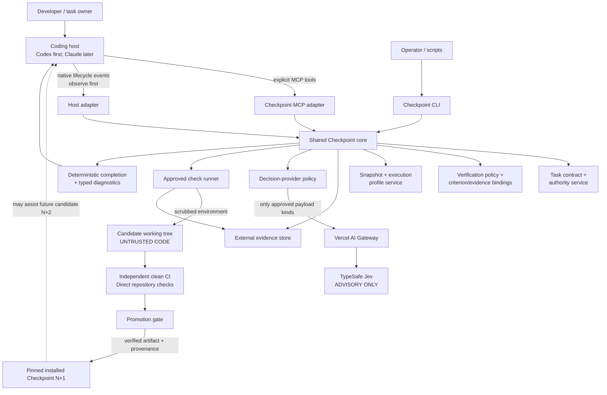
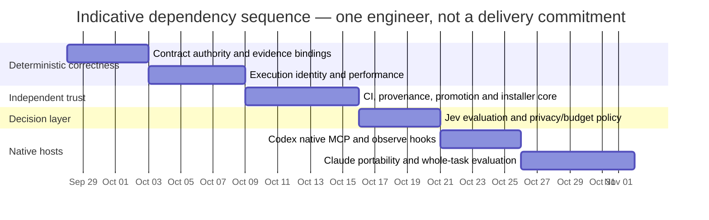
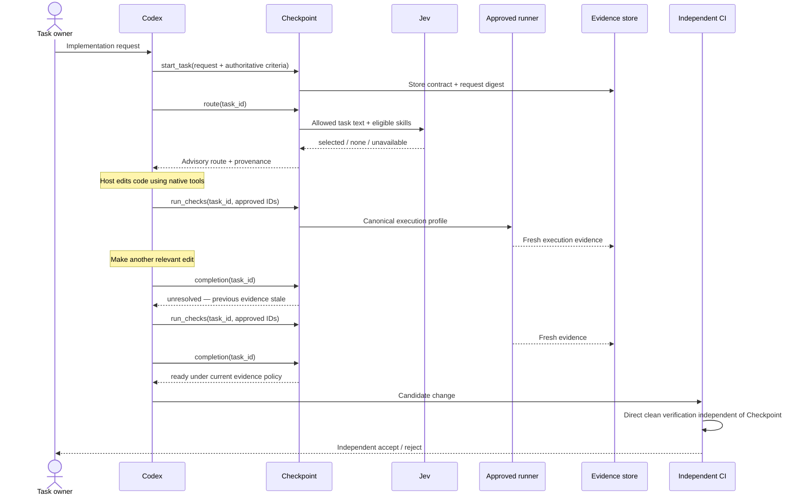

# Agent Checkpoint Harness: Validation and Improvement Research Report

**Research date:** September 28, 2026  
**Activation snapshot analyzed:** September 27, 2026  
**Scope:** Agent Checkpoint 0.1.2, Codex, MCP 2.x, TypeSafe Jev through Vercel AI Gateway, Windows/PowerShell, future Claude Code support.

## Executive summary

The September 27 activation is a meaningful engineering milestone: Agent Checkpoint is no longer a design artifact. The supplied record describes a separately installed, noneditable 0.1.2 runtime, shared CLI/MCP core, bounded Jev transport, approved-command runner, persistent evidence, snapshot freshness, request replay controls, 96 offline tests, package builds, and a real cross-transport stale-evidence incident that the system correctly rejected until fresh checks were run. That directly supersedes older project documents that still describe the repository as documentation-only. fileciteturn0file0 fileciteturn0file1 fileciteturn0file2

The most important conclusion is:

> **The evidence/freshness subsystem is currently much better validated than the Jev subsystem, and it should remain the product's center of gravity. Do not build automatic hooks or more semantic review machinery next.**

The strongest observed behavior is not that Jev selected `backend-testing`; it is that Checkpoint refused to reuse MCP-generated evidence after discovering that CLI and MCP had different Windows execution environments. Current MCP Python SDK code deliberately inherits only a restricted Windows environment, which explains why transport-dependent variables can differ unless explicitly forwarded. citeturn12search0 The MCP v2 line also deliberately standardized timeout values as numeric seconds, matching the `timedelta` compatibility failure recorded in the activation. citeturn12search6

The principal correctness hole is **criterion-to-evidence semantics**. A current check can prove that a command passed; it does not prove that the command meaningfully tested a particular user requirement. A passing generic test suite therefore cannot, by itself, justify “criterion X is satisfied.” The report already acknowledges this, but it is important enough to move from “known limitation” to the next architectural work item. A future `ready` result should mean precisely: **all evidence obligations declared by the authoritative task/verification policy are satisfied by fresh evidence**—not “the feature is objectively correct.”

The second major gap is **independent trust**. A wheel hash proves artifact identity, but the activation had no source commit attached to that artifact; local SQLite/blob integrity cannot defend against a hostile process with the same user permissions; the approved runner is process-controlled but not filesystem/network sandboxed; and independent CI is not yet part of promotion. MCP's own security guidance warns that local MCP servers execute with client privileges and recommends minimal privileges, restricted filesystem/network access, and sandboxing where practical. citeturn18view0turn18view1 GitHub similarly warns that persistent self-hosted runners can be compromised by untrusted code; for independent release verification, ephemeral hosted or otherwise freshly provisioned execution is preferable. citeturn13search0turn13search11

The third gap is **the trust path to the pinned runtime**. The report says the authority is a separately installed noneditable 0.1.2 runtime, but operators invoke `./scripts/checkpoint.ps1`, and project MCP configuration necessarily lives in the mutable checkout. If any mutable repository launcher executes before the pinned installation is reached, candidate N+1 can potentially alter the path used to invoke N. This should be explicitly tested and, for self-development, eliminated: native host configuration should ultimately target an installer-owned, version-pinned launcher outside the candidate checkout.

The Jev review returning `insufficient` is probably the right outcome for the supplied payload. Jev received criterion text plus check IDs/status summaries but not test semantics, coverage, source, diff, or relevant assertions. TypeSafe recommends Jev for narrow typed decisions and documents limitations with indirection, irrelevant context, adversarial content, and multi-step reasoning. citeturn9view0turn10view0 Consequently, **`checkpoint_review` should be removed from the default substantive-task path for now**. Keep it available for experiments, but do not spend a remote call merely to rediscover that a test status does not establish semantic coverage.

The two real routing selections are useful connectivity evidence, not routing-quality evidence. TypeSafe's published skill-selection experiment is encouraging—it reported lower wrong-skill and unnecessary-skill rates with a two-stage Jev design—but it used 488 requests, 182 skills, and a particular Claude model/harness. It does not validate Agent Checkpoint's one-call routing policy. citeturn9view3 LangChain and Browserbase independently demonstrate the more general pattern that looks promising here: **deterministic code constructs the allowed candidate set, Jev makes a bounded classification/selection, and code retains execution authority**. citeturn22view0turn20search2

### Recommended next work package

The next implementation package should combine three tightly related deterministic improvements:

1. **Authoritative criterion/evidence bindings** so `ready` has a precise meaning.
2. **Canonical execution profiles** so CLI, MCP, hooks, and later CI calculate freshness identically.
3. **Typed diagnostic `next_actions`** so an agent can act on `fail`, `stale`, `missing`, and `interrupted` states without turning Checkpoint into an autonomous executor.

Immediately after that, add independent CI/promotion provenance. Only then validate native Codex invocation and observe-only hooks.

For Jev, the recommended policy is:

**Keep routing available in advisory/evaluation mode; disable routine semantic completion review until a held-out benchmark demonstrates that a minimal approved evidence packet adds useful signal. Keep provider failure as `unavailable`/abstention, with no silent alternate-model fallback.**

This aligns with TypeSafe's own definition of Jev: it returns typed choices, scores, and binary probabilities; it does not generate code or execute tools. citeturn9view0turn9view1 It also matches the project's original exploratory principle of deterministic-before-probabilistic decision making. fileciteturn0file3

## Current-state audit and material gaps

### What has actually been established

The table below distinguishes evidence from inference. “Observed” means the September 27 report says it happened; it is not an experiment independently reproduced during this research.

| Area | Current state | Assessment |
|---|---|---|
| Installed runtime | **Observed:** noneditable 0.1.2 outside the checkout; wheel/runtime files compared; prior state/builds retained | Strong basis for N→N+1 self-adoption |
| CLI | **Observed:** working on the real repository | Established |
| MCP server | **Observed:** standalone client called all five tools successfully | Protocol path established |
| Native Codex MCP invocation | Config parsing established; native in-session invocation not demonstrated at snapshot | **Still open** |
| Evidence freshness | Cross-transport environment mismatch caused stale rejection; fresh parity checks then passed | **Strong positive validation** |
| Request replay/accounting | Implemented according to supplied architecture | Needs crash/concurrency expansion |
| Jev connectivity | Three real requests through Vercel Gateway, no retries/fallback | Established only as connectivity/usage |
| Jev routing effectiveness | Two real selections of `backend-testing` | **Not established** |
| Jev completion-review usefulness | One result: `insufficient` | **Not established; current input appears underpowered** |
| Mechanical completion | Current checks and snapshot yielded `ready` | Established only relative to declared evidence policy |
| Criterion semantic coverage | Generic checks may be bound to semantic criteria without proving the behavior | **Major unresolved correctness gap** |
| Runner process lifetime | Windows Job Object management described and tested | Useful containment; **not a security sandbox** |
| Local evidence trust | External SQLite/blob store with hashes | Good against accidental staleness; not malicious same-user tampering |
| Independent CI | Not established | **P0 gap before stronger adoption** |
| Hooks | Not implemented | Correctly deferred |
| Claude Code | Installed but not configured/validated | Correctly deferred |
| Installer/uninstaller | Not implemented | Required before portable distribution |
| Authenticated manual evidence | Domain model anticipates it; submission surface absent | Remains `unknown`, correctly |
| Whole-agent benefit | Historical tiny workflow study showed significant overhead; no autonomous-agent efficacy study | **Product benefit not proven** |

The historical 0.1.1 fixture results are especially important: the intervention added roughly 7.3 seconds to a passing micro-workflow, 11.9 seconds to failure→repair, and 18.5 seconds to pass→stale→repair. Those measurements are limited by fixed ordering and tiny workloads, but they disprove any assumption that merely adding Checkpoint makes workflows faster. fileciteturn0file0

### Correctness gaps

**Criterion coverage is the most consequential gap.** Checkpoint currently establishes freshness and execution provenance much more rigorously than it establishes *why a passing run supports a particular criterion*. A run of `pytest` may be fresh, authentic, and green while never exercising the requested behavior. The solution is not another generic model judgment. Add an explicit evidence-requirement layer between criteria and runs.

For example:

```yaml
# PROPOSED SCHEMA — YAML rendering for readability.
# The project may continue persisting equivalent data in checkpoint.json.

criteria:
  - id: invalid-input
    origin: user
    authority: request
    requiredEvidence:
      - kind: test_case
        checkId: tests
        assertionId: api.invalid_input_returns_400
      - kind: repository_policy
        policyId: api-error-contract
```

Valid evidence requirement kinds could initially be:

`check_pass`, `test_case`, `artifact_assertion`, `authenticated_manual`, and `repository_policy`. `semantic_advisory` should explicitly remain incapable of satisfying required evidence.

A broad repository-owner policy may deliberately say “the full integration suite is acceptable evidence for criterion X,” but that association must be an **authoritative policy choice**, not an inference manufactured by the coding agent.

**Criterion origin is not authority.** An object saying `"origin": "user"` is merely data unless the system can tie it to the actual request that entered the task. Add an immutable `request_digest`, an `authority` field, and revision rules distinguishing user/repository requirements from agent-derived interpretation. The agent should be allowed to add criteria; it should not be able to rewrite a user-owned criterion into an easier one and retain the same authority.

A useful invariant is:

> Any contract revision can add obligations freely; removing or weakening a user/repository obligation requires an explicit higher-authority record.

**`ready` needs sharper semantics.** The recommended public definition is:

> `ready` = all required evidence obligations in the current authoritative contract and policy are satisfied by current evidence.

That is much safer than wording it as “the implementation is correct.” A Checkpoint report is an evidence-based readiness report, not a proof system.

**Replay needs payload binding.** A stable `request_id` should be idempotent only for the exact canonical operation and input digest. Reusing `checks-1` with different check IDs or a different task revision should be a hard conflict rather than returning or replacing prior results.

### Operational and compatibility gaps

The Windows environment failure was not a trivial configuration mistake; it exposed a fundamental requirement: **execution identity must be host-independent**. The current MCP Python SDK intentionally starts stdio servers with a restricted inherited environment. Its present Windows list includes variables such as `SYSTEMROOT`, `TEMP`, `PATH`, and `USERPROFILE`, but not every ambient variable a normal shell may expose. citeturn12search0

Instead of continuously adding variables discovered through failures, define an explicit execution profile:

```text
ExecutionProfile =
    platform identity
  + runtime/executable identity
  + fixed forwarded-environment schema
  + per-check relevant environment values
  + working-directory identity
  + check-definition digest
  + dependency/lock identity
```

The profile itself gets a digest. CLI, MCP, hooks, and CI should call the same function to build it.

Crucially, **not every environment variable should participate in freshness**. Otherwise harmless shell differences cause false staleness. Each check should declare which environment inputs can affect its meaning.

The MCP timeout preflight failure is consistent with an actual MCP Python v2 migration: the v2 line standardized timeout APIs on `float` values representing seconds. citeturn12search6 This should become a pinned compatibility fixture, not an anecdote.

The protocol itself has also moved. MCP `2026-07-28` is now the current specification and introduced a stateless core, breaking changes, updated Tier-1 SDKs, cacheable catalogs, and a formal extension system. citeturn15view0turn16view0 Checkpoint's explicit `task_id` is therefore exactly the right direction: application state should be represented by an explicit handle rather than depending on a hidden connection/session. MCP's current tool guidance says the same for stateful applications. citeturn17view0

Checkpoint should add `outputSchema` to every MCP tool and validate its own `structuredContent` before sending it. Current MCP requires servers with an output schema to return conforming structured results and recommends client validation. citeturn17view0 Because all five Checkpoint results can naturally be object-shaped, retaining an object root also gives easy compatibility with older clients despite the current protocol supporting arbitrary JSON values.

### Security and privacy gaps

The current runner is correctly described as non-hermetic. Windows Job Objects solve descendant lifetime/termination problems; they do not provide filesystem or network isolation. Windows provides actual security primitives such as AppContainer specifically to restrict files, network resources, processes, and other capabilities. citeturn12search12

For the first production-worthy release, I would **not** require an AppContainer implementation if it would make normal Python/node tooling brittle. Instead:

1. keep a highly scrubbed check-process environment;
2. never inject Jev/Gateway credentials into check subprocesses;
3. support an optional isolated runner profile later;
4. make independent clean CI the release authority.

The current local store should continue to say explicitly that it protects provenance against ordinary mistakes and stale reuse, **not against a hostile process with the same user permissions**.

There is also a subtle credential concern worth resolving before hooks. The report says the Node bootstrap consumes `.env.local`. If that credential file lives within the working checkout and Codex can read the checkout under normal host permissions, excluding it from snapshot contents does **not** make it secret from the coding agent. The stronger design is a user-level environment/secret store outside the candidate checkout, read only by the pinned launcher/provider process.

Likewise, “hosted telemetry disabled” does not mean “nothing exists remotely.” Vercel AI Gateway explicitly advertises request-level usage, spend, token counts, observability, and request logs. citeturn24search1 Its current Jev catalog entry lists TypeSafe's provider but does **not** mark the Jev row as ZDR or “No Training.” citeturn24search7 LangChain's September 21 Jev/LangSmith documentation separately states that TypeSafe does not currently offer zero data retention. citeturn19search0 I did not find a stronger current TypeSafe primary source establishing a ZDR commitment, so the safe policy is:

> Treat every Jev payload as remote data that may be retained according to applicable TypeSafe/Vercel terms unless a reviewed contractual setting says otherwise.

Your current choice not to send source files or raw outputs is therefore a good boundary and should remain the default.

Finally, documentation drift is now a project risk. The older harness prompt and self-adoption roadmap still say the repository is documentation-only even though the new working-MVP artifact explicitly supersedes them. fileciteturn0file1 fileciteturn0file2 Create one machine-readable/current `docs/status.md` or equivalent release-status document and mark historical research pages with explicit “superseded as of 0.1.2” banners.

## Target architecture and integration contracts

### Recommended architecture



The architectural authority order should be:

**user requirements → repository-owned policy → independently observed mechanical evidence → authenticated manual evidence → semantic advice.**

Semantic advice never moves upward through that order because its confidence is high. TypeSafe itself describes Choice/Score confidence as derived from the answer distribution; thresholds are domain-specific and should be tested rather than interpreted as calibrated probability that the engineering conclusion is correct. citeturn9view2

### Output-to-action contract

The current generic non-ready `next_actions` is not enough for an agent harness. Make it a **typed diagnostic schema, not an execution queue**.

| Result | Responsible consumer | Allowed next action | Must not do |
|---|---|---|---|
| Route `selected` | Coding host | Load the named resource if still eligible | Invent a missing skill or bypass mandatory instructions |
| Route `none` | Coding host | Continue without an optional skill | Treat abstention as failure |
| Route `unavailable` | Host/operator | Continue under configured explicit fallback or without advice | Silently switch provider/model |
| Check `pass` | Completion service | Record candidate evidence | Assume unrelated criteria are proven |
| Check `fail` | Coding agent | Inspect bounded output and repair | Convert to pass using semantic judgment |
| Check `stale` | Coding agent | Rerun required check against current execution profile | Reattach historical run |
| Check `missing` | Coding agent | Run declared requirement or request permitted attestation | Claim execution occurred |
| Check `interrupted` | Operator/agent | Confirm old process ended; issue new explicit request | Replay potentially side-effecting work invisibly |
| Review `supported` | Agent/reviewer | Investigate/use as advisory corroboration | Satisfy required mechanical evidence |
| Review `contradicted` | Agent/reviewer | Investigate likely gap | Automatically rewrite code without host authority |
| Review `insufficient` | Agent | Obtain better evidence or skip semantic judgment | Repeatedly call Jev with the same information |
| Completion `ready` | Agent/operator | Hand off evidence-backed result | Claim universal correctness |
| Completion `needs_changes` | Agent | Follow deterministic repair diagnostics | Finish as completed |
| Completion `unresolved` | Agent/operator | Gather missing evidence or report unresolved | Collapse unknown into success |

A proposed v2 diagnostic shape is:

```json
{
  "schema_version": "2",
  "status": "unresolved",
  "next_actions": [
    {
      "kind": "refresh_stale_evidence",
      "priority": "required",
      "criterion_ids": ["invalid-input"],
      "check_ids": ["api-tests"],
      "reason_code": "EXECUTION_PROFILE_CHANGED",
      "evidence_ids": ["run_old"],
      "authorized_execution": false,
      "replay_safe": true
    }
  ]
}
```

Useful action kinds are `run_check`, `inspect_check_output`, `refresh_stale_evidence`, `request_manual_attestation`, `resolve_contract_gap`, and `inspect_advisory`. There should be **no arbitrary command string** in this structure.

`authorized_execution:false` is intentionally explicit: Checkpoint tells the host what evidence is missing; the host's own permission system still decides whether the associated action may run.

### Integration requirements and capability contracts

#### Codex

OpenAI currently documents project-scoped MCP configuration in `.codex/config.toml` for trusted projects, alongside user-level configuration, and the configuration is shared across Codex surfaces. Documented server keys include `command`, `args`, `env`, `env_vars`, `cwd`, `startup_timeout_sec`, `tool_timeout_sec`, `enabled`, `required`, `enabled_tools`, `disabled_tools`, `default_tools_approval_mode`, per-tool approval configuration, and per-tool output limits. citeturn2view0turn3view5

Codex's current lifecycle hook surface includes `SessionStart`, `UserPromptSubmit`, `PreToolUse`, `PermissionRequest`, `PostToolUse`, `PreCompact`, `PostCompact`, `SubagentStart`, `SubagentStop`, `Stop`, `Interrupt`, and `SessionEnd`. Hook configuration can be supplied through hook configuration or `[hooks]` configuration, and OpenAI explicitly warns that the transcript format is not a stable hook interface. citeturn23search1

That gives Checkpoint a viable future native adapter, but I recommend this initial mapping:

| Codex event | Checkpoint behavior |
|---|---|
| `SessionStart` | Local doctor/state recovery only; **no Jev call** |
| `UserPromptSubmit` | Observe task association; do not automatically register every chat message |
| `PostToolUse` | Mark relevant workspace generation dirty when known file-changing tools execute |
| `SubagentStop` | Record subassignment outcome if a Checkpoint assignment exists |
| `Stop` | Read-only completion check; initially advisory only |
| `Interrupt` | Mark in-flight host operation context interrupted |
| `PreCompact` / `PostCompact` | Persist/restore task identity references, not private transcript parsing |
| `PreToolUse` | **No Checkpoint security classifier in the MVP** |

Codex custom/subagent workflows are available and OpenAI warns that they consume additional tokens compared with equivalent single-agent work, reinforcing the idea that Checkpoint should recommend delegation only when it has a measurable reason. citeturn4view2

#### MCP 2.x

Checkpoint should support these protocol-level invariants:

| Requirement | Implementation |
|---|---|
| Transport | Local `stdio` remains the simplest Checkpoint transport |
| Application state | Explicit `task_id`; never rely on a transport session |
| Tool list | Stable names and deterministic ordering |
| Inputs | Strict object schemas; reject unknown fields |
| Outputs | `outputSchema` + validated `structuredContent` |
| Compatibility | Object-root outputs for easy older-client compatibility |
| Errors | Separate protocol/input errors from actionable tool execution errors |
| Cancellation | Cancellation leaves evidence unresolved, never pass |
| Timeouts | Explicit host and runtime deadlines; SDK values tested for installed MCP version |
| stdout | Protocol only; diagnostics to stderr |
| Versioning | Pin/lock tested SDK; run contract suite before upgrading |

These choices follow the current MCP specification, which requires schema validation, recommends tool-call timeouts and audit logging, and treats tool descriptions/annotations as untrusted unless the server itself is trusted. citeturn17view0 MCP security guidance also specifically recommends direct stdio for local servers where appropriate because it limits exposure compared with an unnecessary local network listener. citeturn18view1

#### TypeSafe Jev

The minimal provider contract should preserve the TypeSafe concepts rather than inventing “LLM-like” semantics:

```text
input:
    model / alias
    state
    typed questions

native decisions:
    Choice -> selected option + distribution + confidence
    Score  -> ordered score + distribution + confidence
    Noul   -> probability of yes

metadata to retain:
    requested alias
    returned model identifier
    provider request id, when present
    input tokens
    output tokens
    adapter latency
    physical attempt count
```

TypeSafe's current quickstart documents `state`, `model`, and typed `questions`, with the API returning the actual model identifier and token usage. The direct TypeSafe API defaults to `jev-latest`; your Gateway deployment can continue using `typesafe-ai/jev`, but the requested alias and returned model must remain separate fields because an alias is not an attestation to fixed weights. citeturn9view1turn24search7

TypeSafe documents `401`, `422`, `429`, and `529` error conditions and SDK retry behavior for retryable failures. citeturn10view4 Since Checkpoint intentionally promises **no retries today**, add a transport contract test that injects `429` and `529` and proves that exactly one physical request is made. Otherwise an SDK upgrade could silently re-enable retry behavior and violate the six-request budget.

I recommend these fallback semantics:

```text
routing provider disabled      -> configured heuristic/local routing is allowed
routing provider unavailable   -> abstain, unless policy explicitly names heuristic fallback
review provider unavailable    -> semantic advisory unavailable
completion provider unavailable -> NO EFFECT on deterministic completion
alternate remote model         -> never automatic
```

The fallback source must always be recorded.

#### Claude Code

Claude Code now has an extensive hook system including `SessionStart`, `UserPromptSubmit`, `PreToolUse`, `PermissionRequest`, `PostToolUse`, `PostToolUseFailure`, `SubagentStart`, `SubagentStop`, `TaskCreated`, `TaskCompleted`, `PreCompact`, `PostCompact`, `Stop`, `StopFailure`, `ConfigChange`, `CwdChanged`, `FileChanged`, and worktree lifecycle events. Project hooks live in `.claude/settings.json`; project MCP configuration belongs in `.mcp.json`; skills and subagents have separate project directories. citeturn7view0turn25search0

Claude Code also documents `MCP_TOOL_TIMEOUT` in milliseconds and `MAX_MCP_OUTPUT_TOKENS`, so the adapter must not reuse MCP Python's seconds-based timeout value as though the units were the same. citeturn25search1

Do **not** build a shared “Codex/Claude hooks adapter.” Build two thin adapters behind one core capability contract:

```text
HostCapabilities
    tool_access
    structured_tool_results
    session_identity
    working_directory_identity
    lifecycle_observation
    file_change_observation
    subagent_observation
    stop_observation
    stop_control
    cancellation_observation
    per_tool_approval
    hook_deadline
```

A host adapter either advertises a capability or it does not. Checkpoint must never emulate an unavailable enforcement capability by pretending a procedural instruction is equivalent.

## Prioritized improvements and configuration

### Table A — prioritized engineering improvements

Effort ranges assume one engineer already familiar with the current Python codebase; they are engineering estimates, not schedule commitments.

| Priority | Improvement | Effort | Expected impact | Why now |
|---|---|---:|---|---|
| **P0** | Criterion authority + evidence-binding model | 3–5 engineer-days | **Very high correctness** | Closes biggest false-ready gap |
| **P0** | Canonical execution-profile identity across CLI/MCP/future hooks | 3–5 days | **Very high reliability** | Directly motivated by real stale-evidence incident |
| **P0** | Independent CI + source/artifact provenance + promotion gate | 4–7 days | **Critical trust** | Candidate/local store cannot remain promotion oracle |
| **P0** | Move trusted launcher and provider credential path outside candidate checkout | 2–4 days | **Critical self-adoption security** | Completes N vs N+1 trust separation |
| **P1** | MCP output schemas, version contract tests, cancellation/timeout fixtures | 2–4 days | High interoperability | MCP 2.x is moving and already caused one compatibility issue |
| **P1** | Typed deterministic `next_actions` | 2–3 days | High agent usefulness | Converts evidence findings into actionable workflow without autonomous execution |
| **P1** | Change-aware verification profiles | 3–5 days | **High latency reduction** | Current all-check substantive workflow is unnecessarily expensive for some change classes |
| **P1** | Jev policy/eval redesign; disable default completion review | 3–5 days | Medium quality + lower overhead | Current review payload is underinformed |
| **P1** | Native Codex MCP acceptance + observe-only hooks | 3–5 days | High integration confidence | Config parsing is not native invocation |
| **P2** | Idempotent installer/update/uninstaller and `doctor` | 4–7 days | High portability | Needed before using in unrelated repositories |
| **P2** | Claude Code adapter/pilot | 3–6 days | Portability | Should follow a proven Codex path |
| **P2** | Optional stronger Windows sandbox profile | 5–10+ days | Defense-in-depth | Useful but should not block evidence-core validation |

### Reduce verification overhead without weakening correctness

Do not let Jev choose which required checks may disappear. Instead create **policy-owned verification profiles** selected from deterministic changed-surface rules.

Example:

```text
docs-only:
    documentation/lint checks

runtime:
    format + lint + mypy + focused unit tests

mcp:
    runtime + MCP contract tests

runner/snapshot/storage/security:
    full offline suite + Windows integration

release:
    all checks + installed-wheel validation + promotion fixtures
```

If changed files broaden during implementation, requirements should expand monotonically. The task must not retroactively switch to an easier profile to obtain `ready`.

This is where the 0.1.1 negative latency measurement should directly shape engineering. fileciteturn0file0 The performance target for the deterministic harness should be precommitted as:

> **At least a 70% reduction in Checkpoint-only median overhead on the original micro-fixtures, without a freshness regression, before enabling automatic lifecycle integration.**

For a persistent MCP server, separately target sub-second p95 for task-state/readiness bookkeeping **excluding the actual repository checks**. Treat that as a provisional engineering budget; revise it using profiling rather than weakening correctness.

Profile these boundaries independently:

```text
process/bootstrap
config parse
SQLite open/transaction
catalog construction
Git/workspace enumeration
file hashing
executable/dependency identity
check process creation
check execution
output persistence
completion revalidation
Jev transport
```

Cache immutable or content-addressed facts—installed executable hashes, policy parsing, unchanged catalog definitions—but always perform a final content-sensitive freshness validation before returning `ready`.

### Table B — required configuration/schema changes

| Area | Proposed key/contract | Change |
|---|---|---|
| Task authority | `requestDigest` | Immutable digest of original registered request |
| Criterion authority | `origin`, `authority`, `revisionIntroduced` | Separate descriptive origin from authority |
| Evidence binding | `requiredEvidence[]` | Explicit criterion→evidence obligations |
| Execution | `executionProfileDigest` | Stable identity shared by all transports |
| Environment | `forwardedEnv`, `identityEnv` | Distinguish what is passed from what affects freshness |
| Checks | `verificationProfile` | Policy-owned required-check set |
| Diagnostics | `nextActions[].kind/reasonCode/...` | Typed non-executable remediation |
| Provider | `fallbackPolicy` | `abstain`, `heuristic`, never implicit remote fallback |
| Provider | `maxAttempts` | Make physical retry behavior explicit |
| Budget | `maxPhysicalRequestsPerTask` | Retain six by current policy |
| Budget | `maxRequestBytes` | Retain 16 KiB by current policy |
| Budget | `maxProviderLatencyPerTask` | New cumulative latency budget |
| Budget | `maxInputTokensPerTask` | Owner-configurable; **unspecified today** |
| Cost | `maxBilledUsdPerTask` | Optional only when authoritative billed data exists |
| Privacy | `allowedPayloadKinds` | Preserve explicit kinds such as `single_route`, `criterion_evidence` |
| Privacy | `allowSourceContent`, `allowRawCheckOutput` | Explicit false by default |
| Release | `artifactDigest`, `sourceRevision`, `lockDigest` | Reproducible provenance |
| State | `stateSchemaVersion`, `rollbackCompatibility` | Required for migration/promotion |
| MCP | per-tool `outputSchema` | Machine-verifiable responses |

A proposed configuration rendering is:

```yaml
# PROPOSED PROJECT SCHEMA — shown as YAML for readability.
# I do NOT recommend changing checkpoint.json to YAML merely for this.

schemaVersion: 2

execution:
  forwardedEnv:
    - SYSTEMROOT
    - WINDIR
    - TEMP
    - TMP
    - LANG
    - UV_CACHE_DIR

  identityEnv:
    - SYSTEMROOT
    - WINDIR
    - TEMP
    - TMP
    - LANG
    - UV_CACHE_DIR

provider:
  kind: jev
  enabled: true
  remoteAllowed: true
  spendAcknowledged: true

  fallbackPolicy: abstain
  maxAttempts: 1

  budgets:
    maxPhysicalRequestsPerTask: 6
    maxRequestBytes: 16384
    maxInputTokensPerTask: "<owner-defined>"
    maxCumulativeAdapterSeconds: "<owner-defined>"
    maxBilledUsdPerTask: null

privacy:
  allowedPayloadKinds:
    - single_route
    - criterion_evidence
  allowSourceContent: false
  allowRawCheckOutput: false
  contentTelemetry: false

completion:
  semanticAdviceCanSatisfyRequiredEvidence: false
```

The `maxBilledUsdPerTask:null` value deliberately means **unknown/not enforced**, never zero.

Vercel now supports real API-key spend budgets with daily, weekly, monthly, or non-resetting periods, and rejects later requests after the key reaches its quota. citeturn24search0 Use a dedicated Checkpoint key with an external Gateway budget in addition to local request/token limits. The reported $5 limit should remain “operator-reported/unverified” until an operator explicitly attests its current setting. Vercel's public pricing page also documents a $5 free-credit arrangement, but that is distinct from a deliberately configured per-key cap. citeturn24search6

### Codex project configuration

The keys below are documented Codex TOML syntax; the values are the proposed Checkpoint policy. OpenAI documents `startup_timeout_sec`, `tool_timeout_sec`, `required`, tool allowlists, environment forwarding, and approval controls for MCP servers. citeturn2view0turn3view5

```toml
# DOCUMENTED CODEX KEYS; PROPOSED VALUES.
# Replace the placeholder with an installer-owned pinned launcher OUTSIDE
# the candidate checkout.

[mcp_servers.agent-checkpoint]
command = "<pinned-installed-checkpoint-launcher>"
args = []
cwd = "D:\\Programming\\agent-checkpoint"

startup_timeout_sec = 30
tool_timeout_sec = 600

enabled = true
required = false

enabled_tools = [
  "checkpoint_start_task",
  "checkpoint_route",
  "checkpoint_run_checks",
  "checkpoint_review",
  "checkpoint_completion",
]

env_vars = [
  "SYSTEMROOT",
  "WINDIR",
  "TEMP",
  "TMP",
  "LANG",
  "UV_CACHE_DIR",
]

default_tools_approval_mode = "prompt"
```

`required = false` is the correct default for self-development: a broken Checkpoint must not make the repository impossible to open.

Do **not** place `AI_GATEWAY_API_KEY` in project-scoped TOML. The secret should enter only at the installed provider/bootstrap boundary.

### Claude project configuration

Claude Code uses project `.mcp.json` for team-shareable MCP and `.claude/settings.json` for hooks/permissions. citeturn25search0 A future MCP entry should resemble:

```json
{
  "mcpServers": {
    "agent-checkpoint": {
      "type": "stdio",
      "command": "<pinned-installed-checkpoint-launcher>",
      "args": [],
      "env": {}
    }
  }
}
```

That is a **proposed project entry using documented Claude MCP keys**, not something validated against this repository yet. Native Windows behavior must be part of the Claude milestone rather than inferred from Codex success.

## Validation milestones and test matrix

### Six-milestone implementation sequence



The ordering is intentional. Native lifecycle enforcement is downstream of evidence correctness and independent promotion. Jev usefulness is evaluated before it becomes a routine lifecycle cost.

### Milestone acceptance criteria

**Contract authority and evidence bindings**

Completion must reject a task whose required criterion lacks an authorized evidence binding. User/repository criteria cannot be weakened without a higher-authority revision. Same `request_id` plus different canonical input must be rejected. `next_actions` must contain only schema-enumerated diagnostics, never executable free text.

**Execution identity and performance**

CLI and MCP must derive the same `executionProfileDigest` from the same repository state. Changing a declared relevant environment value must stale evidence; changing an undeclared irrelevant value must not. Relevant source edit→revert cycles must still be correctly detected according to the existing generation policy. Final completion must revalidate snapshot/evidence after all required checks. The original tiny-workflow Checkpoint-only median overhead should fall by at least 70% before automatic hooks are considered.

**Independent CI, provenance, promotion, installer core**

A clean CI job must run authoritative commands **without Checkpoint**. The built wheel must be installed into a separate environment and tested there. Promotion manifests must record source revision, artifact SHA-256, dependency-lock digest, Python/MCP/TypeSafe versions, state schema, policy/config digest, and rollback artifact/state compatibility.

GitHub recommends least-privilege workflow tokens and pinning third-party Actions to full commit SHAs; self-hosted runners are explicitly riskier because they are not guaranteed to start clean. citeturn13search8turn13search0 Prefer GitHub-hosted/ephemeral runners for independent validation where available.

Installer tests must prove:

```text
dry-run -> no file changes
first apply -> expected owned edits only
second apply -> zero semantic change
upgrade -> exact diff and backup
uninstall -> removes only owned integration
corrupt active runtime -> manual disable still works
incompatible DB migration -> previous binary + previous compatible state restore
```

**Jev evaluation and policy**

Keep `checkpoint_review` out of the mandatory AGENTS.md path during this milestone.

Build two held-out datasets: skill routing and criterion/evidence judgment. Compare deterministic heuristic, coding-model self-judgment, and Jev. Preserve `none`/`insufficient` cases. A decision to leave Jev disabled is an acceptable successful milestone result.

TypeSafe's own skill-routing cookbook shows that Jev can improve routing on its benchmark, while Browserbase reports a successful candidate-selection/fallback design in Stagehand. Both are evidence that the pattern is worth testing, not evidence that Checkpoint already benefits. citeturn9view3turn20search2

The completion-review dataset should specifically measure **overclaiming**: whenever the payload contains only a green check status but no semantic link to the criterion, the desired label should often be `insufficient`.

Provider fault fixtures must cover:

```text
401 -> unavailable/auth_error, one attempt
422 -> invalid_request, no retry
429 -> policy-defined retry behavior; default one physical attempt
529 -> policy-defined retry behavior; default one physical attempt
timeout -> unavailable
malformed response -> unavailable
returned alias mismatch -> unavailable/security event
budget exhausted -> unavailable/budget
```

**Native Codex integration**

After restarting/reloading the native connection, Codex itself—not a standalone MCP client—must discover the five tools and successfully call them. The test artifact should record the actual host version and tool call events.

Then add **observe-only** hooks. No Stop hook should force continuation yet. A broken MCP server must not prevent Codex startup because `required=false`. Hooks must not issue Jev calls by default, rerun tests automatically, recurse when Checkpoint tests itself, or infer task completion from transcript scraping. OpenAI explicitly warns that transcript format is not a stable hook contract. citeturn23search1

**Claude portability and whole-task evaluation**

Validate `.mcp.json`, project trust/permissions, Windows launch, tool calls, timeout behavior, restart/resume, worktree behavior, and relevant lifecycle hooks independently. Claude Code exposes richer lifecycle events than Codex in some areas, so parity should mean **shared Checkpoint semantics**, not identical hooks. citeturn7view0turn25search0

Then run whole-task experiments. Randomize or counterbalance conditions; keep repository/base revision, task, coding model, host version, acceptance tests, and cache/warm-start treatment controlled. Measure accepted task success, false-ready rate, first-ready corrections, wall time, human intervention, agent usage when obtainable, Checkpoint overhead, Jev usage, and billed dollars only when actually reported.

Do not select an arbitrary sample size now. Run a small variance-estimation pilot, define the minimum practically meaningful effect, then power the release experiment from that variance. The project's existing n=3-per-condition micro-study is useful overhead evidence but not a causal whole-agent benchmark. fileciteturn0file0

### Table C — test-to-acceptance matrix

| Test ID | Test | Acceptance criterion |
|---|---|---|
| `T-CONTRACT-01` | Agent tries to remove user-owned criterion | Revision rejected or requires explicit higher-authority approval |
| `T-CONTRACT-02` | Same request text registered twice | Stable digest/provenance; no accidental duplication |
| `T-REPLAY-01` | Same request ID, same canonical payload | Returns/reconciles same operation safely |
| `T-REPLAY-02` | Same request ID, different payload | Hard conflict; never executes changed request |
| `T-BIND-01` | Green generic suite but criterion has no binding | Criterion remains `unknown` |
| `T-BIND-02` | Targeted current evidence fulfills binding | Criterion can resolve `pass` |
| `T-ENV-01` | CLI versus MCP with same declared env | Same execution-profile digest |
| `T-ENV-02` | Change irrelevant ambient variable | Evidence remains current |
| `T-ENV-03` | Change relevant environment input | Evidence becomes stale |
| `T-SNAPSHOT-01` | Edit after pass | Prior result becomes stale |
| `T-SNAPSHOT-02` | Edit/revert race | Generation/fingerprint policy produces documented result; no false currentness |
| `T-PROCESS-01` | Test spawns child then parent exits | No orphan process survives according to runner policy |
| `T-PROVIDER-01` | Jev 429/529 fixture | Physical attempt count exactly matches configured policy |
| `T-PROVIDER-02` | Timeout/malformed/mismatched model metadata | `unavailable`; never semantic pass |
| `T-PRIVACY-01` | Source/raw output passed to default provider builder | Request rejected before network |
| `T-SECRET-01` | Check prints/accesses provider env | Gateway credential absent from subprocess environment |
| `T-MCP-01` | All five outputs against `outputSchema` | 100% schema-valid |
| `T-MCP-02` | Numeric-timeout compatibility fixture | MCP 2.2.x client preflight succeeds |
| `T-MCP-03` | Server stderr/stdout fixture | stdout contains MCP protocol only |
| `T-CI-01` | Candidate reports ready but direct CI fails | Promotion fails |
| `T-CI-02` | Candidate modifies Checkpoint policy/check definitions | Change is visible to independent review/status checks |
| `T-UPGRADE-01` | Candidate migrates DB incompatibly | Previous artifact + previous compatible state restore successfully |
| `T-INSTALL-01` | Init twice | Second run idempotent |
| `T-INSTALL-02` | Uninstall with pre-existing host config | Non-Checkpoint configuration byte/semantically unchanged |
| `T-CODEX-01` | Native Codex session after restart | Five tools discoverable; at least one real native invocation recorded |
| `T-CODEX-02` | MCP unavailable | Codex repository remains usable via direct commands |
| `T-HOOK-01` | Repeated Stop/interrupt/restart | No duplicate checks, no infinite loop, no budget reset |
| `T-CLAUDE-01` | Native Claude MCP and hook fixture | Shared contract semantics hold despite host-specific events |
| `T-E2E-01` | Route→edit→check→edit→stale→rerun→complete | Old evidence rejected; fresh evidence yields expected status |
| `T-E2E-02` | Same flow with Jev unavailable | Deterministic completion unaffected |
| `T-E2E-03` | Same flow with Jev `insufficient` | Advisory retained; does not satisfy or invalidate required mechanical evidence |
| `T-E2E-04` | Local ready, independent clean CI failure | Final promotion rejected |

### End-to-end release scenario

The canonical release fixture should now test more than “all five MCP tools work”:



The release criterion is not merely that this happy path passes. The same fixture must pass with Jev disabled, Jev unavailable, an interrupted check, mismatched environment, stale check, missing skill, and a failing independent CI result.

## Security, privacy, and risk controls

### Risk matrix

| Risk | Likelihood now | Impact | Current mitigation | Required mitigation | Residual risk |
|---|---|---|---|---|---|
| **Model judgment wrong/overconfident** | Medium–high | Medium while advisory; critical if promoted to authority | Semantic advice separate from completion | Keep advisory; held-out eval; abstention; never override mechanical evidence | Medium |
| **Stale evidence accepted** | Medium | **Critical** | Snapshot/generation/definitions/env identity; real stale rejection observed | Canonical execution profile, cross-transport parity tests, final revalidation, clean CI | Low–medium |
| **Criterion falsely “proven” by irrelevant passing test** | **High** | **High** | Known limitation only | Explicit authoritative criterion→evidence bindings | Medium |
| **Gateway credential leakage to candidate/check** | Medium | **Critical** | Bootstrap consumes key; check subprocess excludes it | Store secret outside checkout; clean child env; provider process separation; secret-leak tests | Low–medium |
| **Remote payload/privacy leakage** | Medium | High | Payload-kind allowlist; no source/raw output | Treat Jev as non-ZDR unless proven; data classification; redaction; separate consent for richer evidence | Medium |
| **Local evidence tampering by same-user process** | Medium | High | External state + hashes | Do not claim hostile-process integrity; independent CI/promotion | Medium locally; low for release |
| **CI bypass/self-approval** | High until CI exists | **Critical** | Manual promotion discipline | Required independent status checks, protected default branch, least privileges, reviewed policy changes | Low–medium |
| **Mutable repo launcher redirects “pinned” harness** | Unverified/medium | **Critical** for self-use | Pinned installed wheel | Installer-owned external launcher; manifest verification; repo launcher only convenience | Low |
| **Hook recursion/continuation loop** | Not active yet | High once hooks enabled | None needed today | Observe first; durable dedupe IDs; continuation budget; manual host-level disable | Low–medium |
| **SDK/config drift** | Medium | Medium–high | `uv.lock`, package pin | Compatibility suite for MCP/TypeSafe/host config; upgrade gate | Low |
| **Cost runaway** | Low today | Medium | 6 requests/task, 16 KiB, 10 s, no retries | Dedicated Gateway key budget + cumulative token/latency accounting | Low |

### CI and runner trust

Independent CI should never use `checkpoint_completion == ready` as its acceptance oracle. It should invoke the authoritative repository commands directly from a clean candidate checkout/package.

A practical first workflow is:

```text
trusted CI workflow
    checkout candidate
    install locked dependencies
    run format check
    run lint
    run mypy
    run unit/integration tests
    build wheel/sdist
    create separate venv
    install built wheel
    run CLI contract smoke
    run MCP protocol smoke
    verify artifact/provenance manifest
```

Live Jev should **not** be part of the required deterministic CI path. Keep provider mocks there. A live provider smoke can be a manually authorized, non-release-blocking workflow using a separate low-budget credential.

GitHub recommends explicitly minimizing `GITHUB_TOKEN` permissions and pinning third-party Actions to full commit SHAs because movable tags can be retargeted. citeturn13search8 It also warns against executing untrusted pull-request code in privileged `pull_request_target` workflows and recommends isolated/ephemeral compute. citeturn13search2

### Jev privacy and adversarial input

Do not expand the current remote payload until it earns value.

TypeSafe explicitly documents that Jev can be distracted by irrelevant state and can be steered by adversarial content; it advises filtering state and using code for problems such as numerical reasoning and structural invariants. citeturn10view0turn10view3 That is particularly relevant to code repositories because files themselves are untrusted inputs.

If semantic completion review is revisited, a minimal evidence packet should be something like:

```json
{
  "criterion": {
    "id": "invalid-input",
    "text": "Invalid input returns 400"
  },
  "policy": {
    "expected_behavior": "Validation errors map to HTTP 400"
  },
  "evidence": [
    {
      "kind": "test_case",
      "name": "test_create_user_invalid_payload_returns_400",
      "status": "pass",
      "freshness": "current",
      "provenance": "checkpoint_runner"
    }
  ],
  "question": {
    "choices": [
      "supported",
      "contradicted",
      "insufficient"
    ]
  }
}
```

Do **not** start by sending source files, entire diffs, raw logs, or full transcripts.

The evidence packet itself must be built deterministically from current recorded objects. Jev must not receive stale evidence and be asked to decide whether it is fresh; freshness is a property Checkpoint can establish in code.

### Cost and telemetry policy

Current public Vercel metadata lists `typesafe-ai/jev` at $0.04 per million input tokens, but the activation's actual billed dollars were not returned, so **actual local cost remains unknown**. citeturn24search7 Do not backfill `billed_usd` from a catalog price; catalog pricing, promotions, credits, or provider routing can change.

Track three distinct layers:

```text
observed usage:
    physical_requests
    input_tokens
    output_tokens
    adapter_seconds

catalog estimate:
    optional, clearly labeled estimate
    model/pricing version + timestamp

billed fact:
    populated only from authoritative Gateway billing data
```

Unknown billed cost must remain `null`, never `0`.

There is little reason to add LangSmith solely for this harness. LangChain now supports Jev evaluation in LangSmith and publishes useful experiments, but hosted tracing would add another data boundary and dependency without solving a current Checkpoint requirement. citeturn19search0 Retain the direct TypeSafe/Gateway stack unless profiling or evaluation exposes a concrete deficiency.

## Source-grounded decisions and open questions

### What to keep, change, defer, and remove

| Decision | Recommendation | Basis |
|---|---|---|
| Pinned predecessor assists candidate | **Keep** | Correct self-adoption architecture |
| External state/evidence | **Keep** | Prevents candidate writes from constantly invalidating itself |
| Explicit `task_id` | **Keep** | Aligns with current MCP stateless design |
| Approved argv, no shell | **Keep** | Smaller execution surface |
| Mechanical readiness reducer | **Keep and strengthen** | Most validated portion of system |
| Jev skill routing | **Keep as advisory/evaluation** | Plausible external evidence, insufficient local accuracy data |
| Routine Jev completion review | **Remove from default flow for now** | Current payload lacks semantic evidence |
| No alternate remote model fallback | **Keep** | Reproducible semantics and clear data boundary |
| Heuristic routing fallback | **Allow only if explicitly configured and labeled** | Low-risk routing decision |
| Semantic blocking | **Defer** | No local accuracy/calibration evidence |
| Codex hooks | **Observe-only after native MCP validation** | Hooks now exist, but automation is unvalidated |
| Automatic continuation | **Defer** | No benefit evidence; loop risk |
| Claude integration | **Defer until Codex path is proven** | Avoid two host-specific debugging fronts |
| LangChain/LangGraph dependency | **Do not add** | Current direct stack already solves the identified transport problem |
| LangSmith hosted telemetry | **Do not add by default** | Adds unnecessary remote data boundary |
| Installer | **Add before cross-repo adoption** | Needed for pinned, reversible integration |
| Independent CI | **Add now** | Required trust boundary for promotion |

LangChain's September 17 harness article is useful external confirmation that Jev is well suited to bounded model-routing and action-classification decisions, but it is explicitly a complement to the generative agent, not a replacement for it. citeturn22view0 Browserbase's Stagehand experiment similarly uses Jev to classify and select bounded browser-action candidates before deterministic execution, falling back when selection is inadequate; that pattern is much closer to Checkpoint routing than to proving software task completion. citeturn20search2

### Public questions now substantially resolved

**Does Codex expose native lifecycle events?** Yes. Current official documentation provides Session, prompt, tool, subagent, compaction, stop, interrupt, and session-end hooks. citeturn23search1

**Does Codex support project MCP configuration and timeout/tool controls?** Yes, with project configuration only in trusted projects. citeturn2view0turn3view5

**Can current MCP express strict Checkpoint tool results?** Yes. `outputSchema` and `structuredContent` are first-class current protocol features. citeturn17view0

**Does MCP itself make a local runner safe?** No. The MCP specification explicitly treats local command execution as a security-sensitive boundary and recommends explicit consent, minimum privileges, and sandboxing/restrictions. citeturn18view0turn18view1

**Does Jev provide an open-ended code-review rationale?** No. Its core interface is typed Choice, Score, and Noul judgments over supplied state. citeturn9view0turn9view1

**Is Jev confidence sufficient to authorize completion?** No. TypeSafe documents it as a distribution-derived signal and recommends domain-specific evaluation of thresholds. citeturn9view2

**Are Claude hooks/MCP sufficiently real to justify a later adapter?** Yes. Claude Code currently has project MCP configuration and a broad documented lifecycle hook surface. citeturn7view0turn25search0

### Owner/local-experiment questions still open

The following cannot be resolved from public documentation:

| Question | Why it matters | Default until resolved |
|---|---|---|
| Does the current repo-local launcher execute mutable checkout code before the pinned runtime? | Determines whether 0.1.2 is truly the authority while editing N+1 | Treat as potential trust gap; move launcher outside checkout |
| Where exactly is the Gateway credential stored? | Determines whether coding agent can read it | Move outside candidate repository |
| What criterion authority UX is acceptable? | Required to distinguish agent inference from owner approval | User/repository criteria immutable; agent additions allowed |
| Which check→criterion bindings are acceptable in this repository? | Defines what `ready` actually means | Do not infer broad semantic coverage automatically |
| Will CI be GitHub-hosted or another system? | Affects promotion/security implementation | Prefer clean/ephemeral execution |
| What is the actual external Gateway key limit? | Needed for independent cost bound | Keep `unverified` |
| What TypeSafe/Vercel contractual retention terms apply to this account? | Determines permissible future evidence packets | Treat as non-ZDR |
| Does current Codex invoke the configured project MCP correctly in a fresh native session? | Final missing native acceptance proof | Test before hooks |
| What value does Jev add over Codex's own skill choice? | Core product hypothesis | Held-out comparative benchmark |
| What value does semantic completion review add? | Determines whether tool deserves to exist | Default disabled until benchmark |

### Authoritative source and claim register

| Source | Current relevance | Claim supported | Limitation |
|---|---|---|---|
| TypeSafe — Jev with coding agents citeturn9view0 | Current | Jev performs typed decisions, not coding/tool execution | Vendor documentation |
| TypeSafe — quickstart citeturn9view1 | Current | API/SDK model, state/questions, returned usage/model | Direct TypeSafe path differs from your Gateway transport |
| TypeSafe — confidence citeturn9view2 | Current | Meaning and limitations of confidence | Does not calibrate your domain |
| TypeSafe — skill suggestion citeturn9view3 | July 2026 experiment | Jev can improve skill routing in one harness | Different model/catalog/workflow |
| TypeSafe — Jev jaggedness citeturn10view0turn10view3 | Reviewed Sept. 2026 | Indirection, irrelevant/adversarial context limitations | Model-specific tests, not Checkpoint eval |
| Vercel — Jev Gateway listing citeturn24search7 | Current | Gateway alias, current catalog pricing, provider flags | Catalog price is not the activation's billed fact |
| Vercel — API-key budgets citeturn24search0 | June 2026 | Per-key spend quotas | External control, not locally attested |
| MCP `2026-07-28` spec citeturn16view0turn15view0 | Current | Stateless protocol, capabilities, updated SDKs | Client adoption may lag |
| MCP tools spec citeturn17view0 | Current | Schemas, structured content, state handles, errors, safety | Protocol contract, not host-specific behavior |
| MCP security guidance citeturn18view0turn18view1 | Current | Local-server execution risks and mitigations | Cannot make same-user storage tamper-proof |
| MCP Python SDK citeturn12search0turn12search6 | Current v2 line | Restricted environment and float-second timeout direction | Installed 2.2.0 still needs local contract tests |
| OpenAI Codex MCP/config citeturn2view0turn3view5 | Current | Project MCP config and exact server control keys | Native Checkpoint invocation still locally untested |
| OpenAI Codex hooks citeturn23search1 | Current | Lifecycle event surface and transcript warning | Hook behavior still needs local acceptance fixtures |
| OpenAI skills practice citeturn23search3 | March 2026 | `AGENTS.md`, `.agents/skills`, deterministic scripts + CI pattern | Throughput observations are vendor case evidence |
| Claude Code configuration citeturn25search0 | Current | `.mcp.json`, `.claude/settings.json`, skill/subagent locations | Native Checkpoint adapter untested |
| Claude Code hooks citeturn7view0 | Current | Broad lifecycle event set | Separate semantics from Codex |
| GitHub Actions security citeturn13search0turn13search8 | Current | Runner and workflow-hardening recommendations | Applies if GitHub Actions is selected |
| Microsoft AppContainer citeturn12search12 | Current | Actual Windows file/network/process isolation primitive | Integration complexity requires local spike |
| LangChain Jev harness citeturn22view0 | Sept. 17, 2026 | External routing/guardrail integration pattern | Not evidence for Checkpoint effectiveness |
| LangChain Jev evaluator citeturn19search0 | Sept. 21, 2026 | External semantic-evaluation experience and ZDR caveat | LangSmith-specific/vendor experiment |
| Browserbase Stagehand/Jev citeturn20search2 | Sept. 21, 2026 | Candidate classification + deterministic execution/fallback pattern | Early Browserbase benchmark |

### Final engineering decision

Agent Checkpoint 0.1.2 has crossed an important threshold: it is sufficiently real to evaluate as infrastructure, but **not sufficiently validated to automate the agent lifecycle or claim improved coding outcomes**. The September 27 environment-parity failure is actually the strongest evidence in its favor: the system detected that apparently successful verification did not apply under a changed execution identity and refused to silently reuse it. That is precisely the sort of failure a useful evidence harness should catch. fileciteturn0file0

The next release should therefore **deepen that capability rather than widen the platform**:

> **Build authoritative criterion→evidence bindings, canonicalize execution identity across transports, produce typed remediation diagnostics, and establish independent CI/promotion provenance. At the same time, remove routine Jev completion review from the default workflow and keep Jev routing as a measured advisory experiment.**

After those invariants pass, prove real native Codex MCP use. Then add observe-only lifecycle hooks. Claude comes after the Codex path demonstrates value. Automatic continuation, semantic blocking, LangGraph orchestration, hosted tracing, and richer remote code-context review should remain deferred.

That path preserves the genuinely useful part of the current MVP, directly addresses the bugs that live use has already exposed, reduces unnecessary model calls, and creates a falsifiable test of the original product thesis rather than assuming that more agent infrastructure is inherently better.
